# O que é física do solo?

## O que é física do solo?

::: {.fragment}

É o ramo da ciência do solo que têm como objetivo caracterizar os atributos físicos do solo...

:::

::: {.fragment}

...Atributos caracterizados por meio de medição, predição e controle dos processos físicos.

:::

::: {.fragment}

Trata do estudo das fases **sólida**, **líquida** e **gasosa** e dos fluxos de fluidos e energia do solo.

:::

::: {.fragment}

Estabeleceu-se como disciplina científica no início do século XX (1901 - 2000)

:::

## O que é o solo fisicamente?

::: {.fragment}

...meio poroso, não rígido, trifásico, formado de partículas que possuem complexidade de forma, tamanho e estrutura mineralógica.

:::

::: {.fragment}

...Sistema (pedosfera) que está relacionado com outros sistemas (litosfera, hidrosfera, atmosfera e biosfera) e que faz parte de sistemas maiores...

:::

# Importância das propriedades físicas do solo

## Importância das propriedades físicas do solo

::: {.incremental}

- As principais propriedades são:
  - Textura.
  - Agregação e estrutura (estabilidade de agregados).
  - Consistência.
  - Densidade do solo e de partículas.
  - Porosidade (macro, micro, total,).
  - Água no solo.

- Importância na relação solo-planta-atmosfera e solo-homem.
  - Condição ideal para trabalhar no solo.
  - Entendimento do solo como meio de suporte para as plantas.
  - Redução da degradação do solo.
  - Preservação de recursos.

:::

## Importância das propriedades físicas do solo

::: {.incremental}

- Algumas delas são alteráveis por meio da ação do homem.

- Conhecimento aplicado em:
  - Erosão;
  - Manejo do solo;
  - Compactação;
  - Irrigação;
  - Drenagem;
  - Uso de água;

:::

# Revisão sobre cálculos simples e unidades de medida

## Unidades de medida do SI

::: {.incremental}

- Comprimento: metro (m);
- Massa: quilograma (kg);
- Tempo: segundo (s);
- Corrente elétrica: ampere (A);
- Temperatura termodinâmica: kelvin (K);
- Quantidade de matéria: mol (mol);
- Intensidade luminosa: candela (cd).

:::

## Unidades de medida do SI

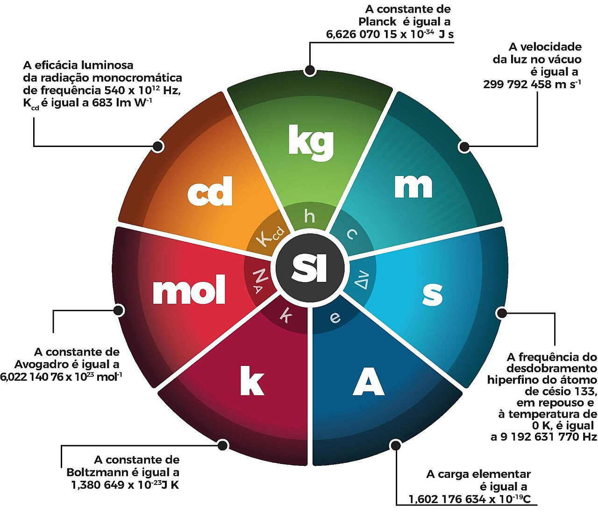{fig-align="center"}

## Área de superfícies planas

O que é área?

::: {.fragment}

É a medida da superfície de uma figura. Expressa comumente na unidade de metros quadrado (m^2^), centímetro quadrado (cm^2^) ou quilômetro quadrado (km^2^).

:::

::: {.fragment}

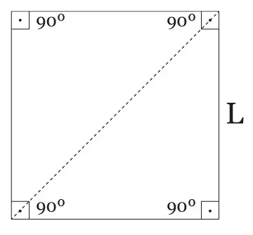

:::

## Área de superfícies planas

[__Retângulo__]{.fg style="--col: #e64173"}

Possui 4 lados e 4 ângulos retos (90º). Lados opostos possuem a mesma medida e são paralelos.

::: {.columns}

::: {.column}

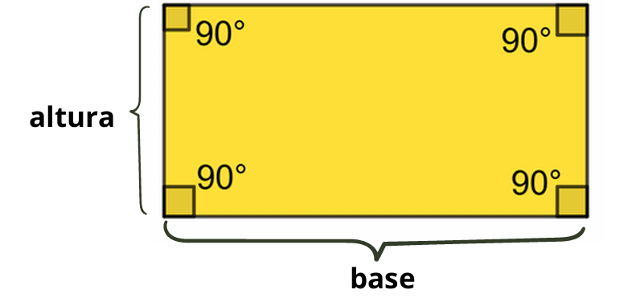

:::

::: {.column}

Área de retângulo: 

$Área = base * altura$

 $A = b*h$

:::

:::

## Área de superfícies planas

[__Quadrado__]{.fg style="--col: #e64173"}

Tipo especial de retângulo onde todos os lados possuem a mesma medida.

::: {.columns}

::: {.column}

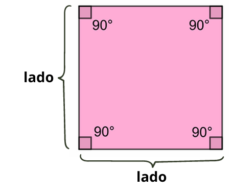

:::

::: {.column}

Área de quadrado: 

$Área = lado * lado$

$A = l^2$

:::

:::

## Área de superfícies planas

[__Paralelogramo__]{.fg style="--col: #e64173"}

Figura com 4 lados, em que os lados opostos são paralelos e têm a mesma medida.

::: {.columns}

::: {.column}

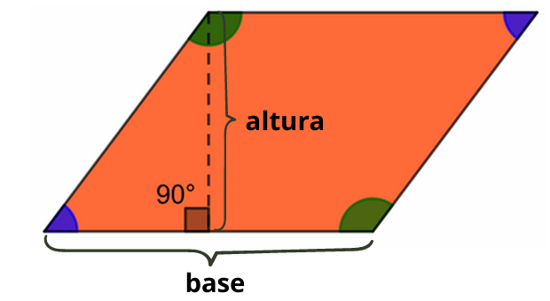

:::

::: {.column}

Área de paralelogramo: 

$Área = base * altura$

$A = b*h$

:::

:::

## Área de superfícies planas

[__Losango__]{.fg style="--col: #e64173"}

Todos os lados com mesma medida. Diagonais se cruzam em ângulo reto (90º).

::: {.columns}

::: {.column}

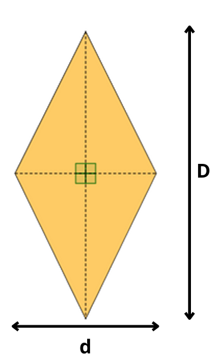{width="45%"}

:::

::: {.column}

Área de losango: 

$Área = \frac{diagonal~maior~*~diagonal~menor}{2}$

$A = \frac{D~*~d}{2}$

:::

:::

## Área de superfícies planas

[__Trapézio__]{.fg style="--col: #e64173"}

Quadrilátero que tem apenas um par de lados paralelos.

::: {.columns}

::: {.column}

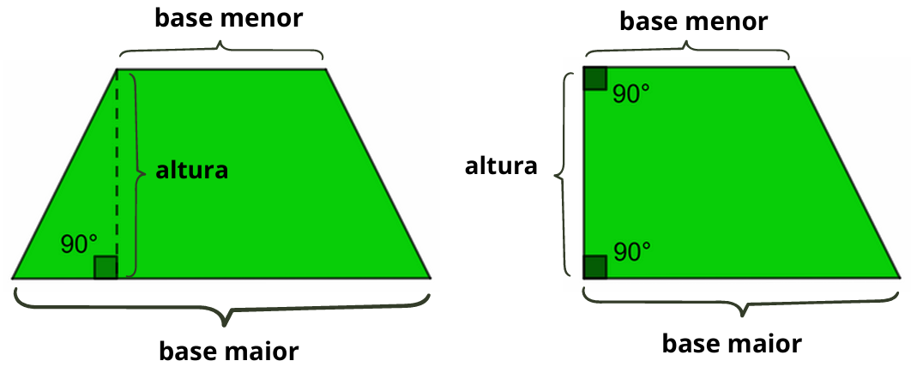

:::

::: {.column}

Área de trapézio: 

$Área = \frac{(base~maior~+~base~menor)~*~altura}{2}$

$A = \frac{(B~+~b)~*~h}{2}$

:::

:::

## Área de superfícies planas

[__Triângulo__]{.fg style="--col: #e64173"}

Figura com três lados. Vários tipos, mas mesma fórmula de área.

::: {.columns}

::: {.column}

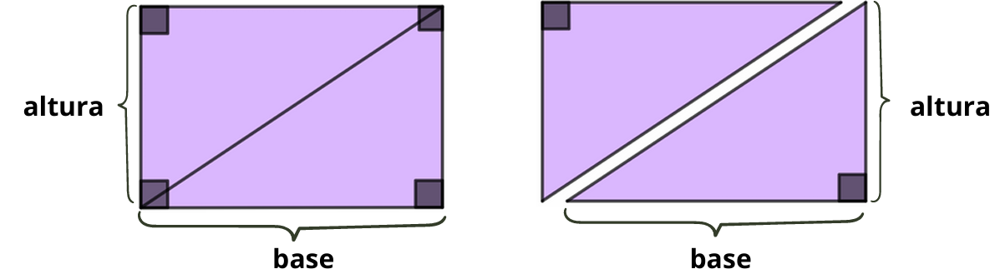

:::

::: {.column}

Área de triângulo: 

$Área = \frac{base~*~altura}{2}$

$A = \frac{b~*~h}{2}$

:::

:::

## Área de superfícies planas

[__Círculo__]{.fg style="--col: #e64173"}

Figura formata por todos os pontos que estão a uma distância menor ou igual ao raio de um ponto central, chamado de centro.

::: {.columns}

::: {.column}

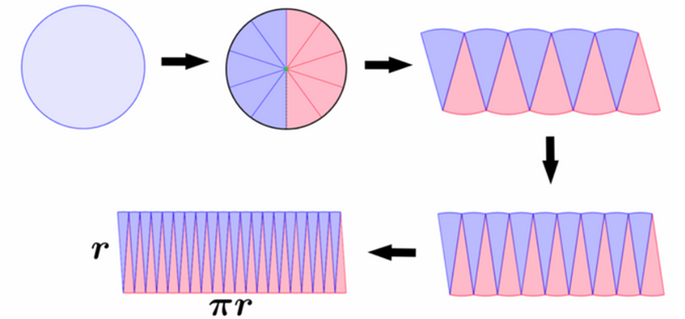

:::

::: {.column}

Área de círculo: 

$Área = altura~(r)*base~(\pi*r)$

$A = \pi * r * r = \pi * r^2$

:::

:::

## Área de superfícies planas

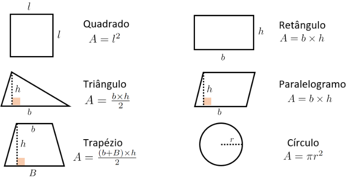{fig-align="center"}

## Área de superfícies 3d

[__Cilindro__]{.fg style="--col: #e64173"}

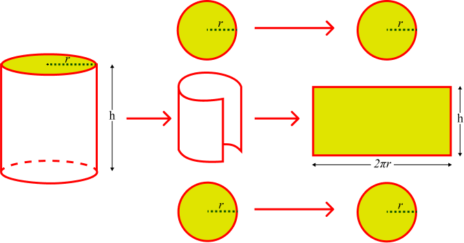

$Área = (2*\pi*r^2) + (2*\pi*r*h)$

## Volume de objetos

O volume de um corpo diz respeito ao espaço que ele ocupa em termos das 3 dimensões.

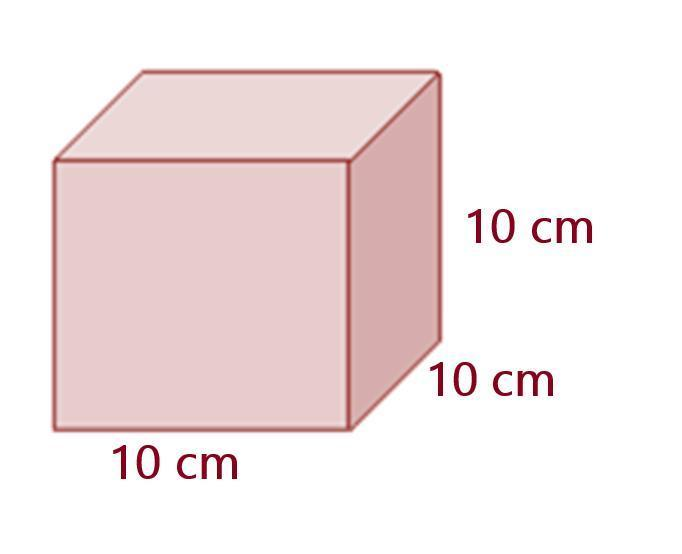

::: {.fragment}

$Volume = 10 x 10 x 10 = 1000 cm^3$

:::

## Volume

[__Cilindro__]{.fg style="--col: #e64173"}

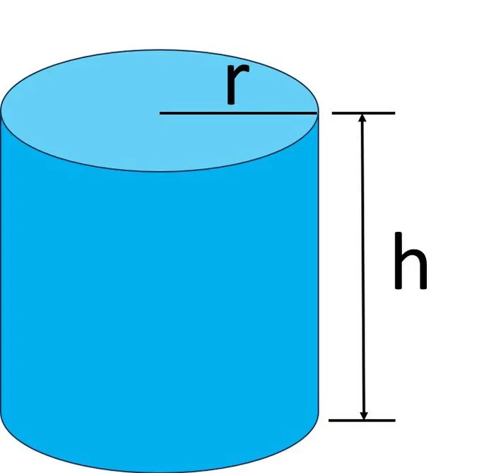

$Área = (2*\pi*r^2) + (2*\pi*r*h)$ e $Volume = \pi * r^2 * h$

## Transformação de unidades

::: {layout-ncol="2"}

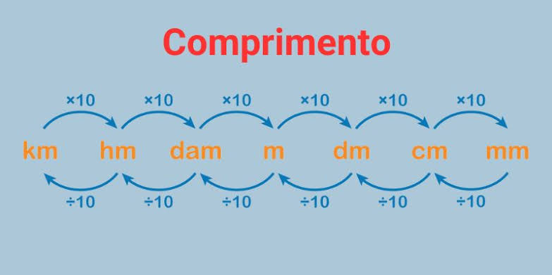

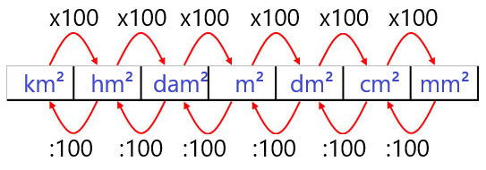

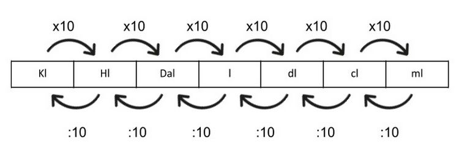

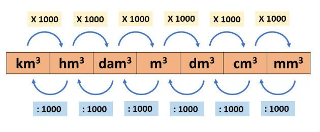

:::

## Outros cálculos importantes

[__Regra de 3__]{.fg style="--col: #e64173"}

::: {.columns}

::: {.column}

- A regra de três simples é uma proporção entre duas grandezas.

ex: Um carro gasta 10 L de gasolina a cada 140 km, quanto o carro gasta em 1000 km:

$$
\begin{array}{c|c}
\text{Distância (km)} & \text{Combustível (L)}\\
\hline
140 & 10\\
1000 & x
\end{array}
$$

:::

::: {.column}

::: {.fragment}

$$
\frac{140}{1000} = \frac{10}{x}
$$

$$
140x = 1000 \cdot 10
$$

$$
x = \frac{10000}{140}
$$

$$
\boxed{x = 71,43\text{ L}}
$$

:::

:::

:::

## Outros cálculos importantes

[__Porcentagem__]{.fg style="--col: #e64173"}

::: {.columns}

::: {.column}

- Forma de medir uma parte em relação ao todo.

ex: Tenho 10% de umidade no solo. Significa que do peso ou do volume total de solo 10 partes são ocupadas pela água. Se for em 100 g de solo são 10 g de água, como:

$10\%= \frac{10*100}{100}= 10g$

$10\%= 0,1*100= 10g$

:::

::: {.column}

::: {.fragment}

$Valor~\%=\frac{valor~final-valor~inicial}{valor~inicial}*100$

::: {.fragment}

- Porcentagens são comutativas.

ex: 10% de 50 é igual que 50% de 10.

$0,1*50 = 5$

$0,5*10 = 5$

:::

:::

:::

:::

# Prática 1

## Prática 1

Lista de questões relacionadas ao conhecimento básico e intermediário em matematica, transformação de unidades e cálculos de área e volume.

::: {.incremental}

- Lista enviada amanhã (11/08/2026) via email.

- Entrega no início da próxima aula teórica (18/08/2026).

:::

# Fim!

