# O que compõe o solo?

## Composição do solo
<hr>

O solo é um corpo natural, trifásico, tridimensional, heterogêneo, dinâmico, formado por materiais minerais e orgânicos, contém matéria viva e pode ser vegetado.

::: {.incremental}

Fases:

- Fase sólida (matriz do solo).

- Fase líquida.

- Fase gasosa.

:::

## Composição do solo
<hr>

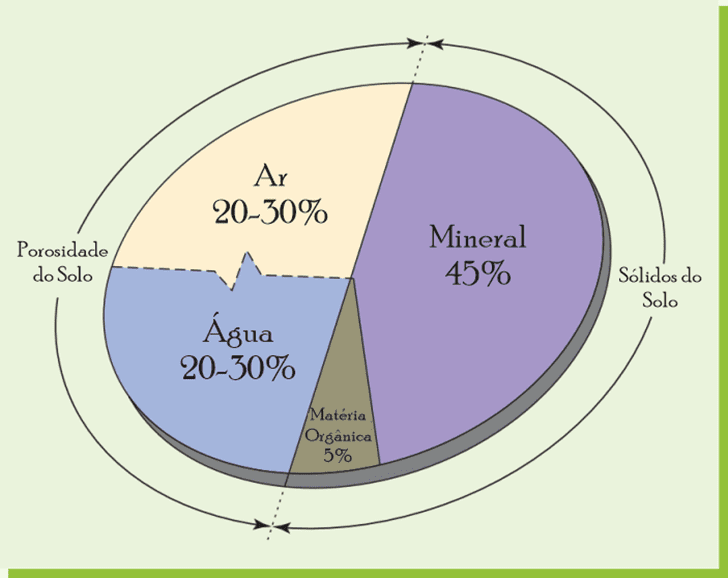{fig-align="center"}

::: {style="font-size: 70%;"}

Representação de um solo (em volume) de textura média em condições ótimas para o crescimento das plantas.

:::

## Composição do solo
<hr>

[__Fase líquida__]{.fg style="--col: #e64173"}

::: {.incremental}

- Ocupa parcialmente ou totalmente o espaço poroso do solo;

- Variação espacial e temporal (condições climáticas, estado de energia no solo e relações solo-planta-atmosfera);

- Responsável pela dissolução e transporte de íons e compostos às plantas;

- Água do solo é diferente de solução do solo;

- Governa a maior parte dos processos que ocorrem no solo, direta ou indiretamente.

:::

## Composição do solo
<hr>

[__Fase gasosa__]{.fg style="--col: #e64173"}

::: {.incremental}

- Espaço poroso momentaneamente não ocupado por água;

- Pode ser considerado o "ar" ou a "atmosfera" do solo;

- Composto por diversos gases.
  - N~2~, O~2~, CO~2~, CH~4~, C~2~H~6~, H~2~S, N~2~O, NO.

:::

## Composição do solo
<hr>

[__Fase sólida orgânica__]{.fg style="--col: #e64173"}

::: {.incremental}

- Geralmente menos de 5%;

- Material orgânico em diferentes estágios de alteração;

- Húmus: substâncias húmicas (80-90% da MOS).

- Fração com alta área superficial específica (ASE);

- Densidade de cargas elétricas na superfície;

- Capacidade de troca de cátions (CTC);

- Afinidade com água;

- Densidade de partícula.

:::

## Composição do solo
<hr>

[__Fase sólida mineral__]{.fg style="--col: #e64173"}

::: {.incremental}

- Partículas minerais herdadas do material de origem do solo ou formadas por processos pedogenéticos;

- Propriedades químicas das partículas minerais;

- Diâmetro das partículas (tamanho);

- ASE;

- Mineralogia influência nas propriedades globais dos solos;

:::

## Composição do solo
<hr>

Composição do solo em volume e peso

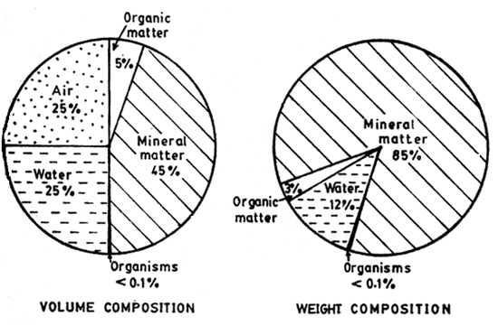{fig-align="center"}

## Composição do solo
<hr>

[__Classificação de diâmetro das partículas__]{.fg style="--col: #e64173"}

<br>

::: {.list-table}

- - Denominação
  - Diâmetro (mm)

- - Matacões
  - \> 200

- - Calhaus
  - 200 - 20

- - Cascalhos
  - 20 - 2

- - Areia grossa
  - 2 - 0,2

- - Areia fina
  - 0,2 - 0,05

- - Silte
  - 0,05 - 0,002

- - Argila
  - < 0,002

:::

## Composição do solo
<hr>

[__Classificação de diâmetro das partículas__]{.fg style="--col: #e64173"}


::: {layout-ncol="2"}

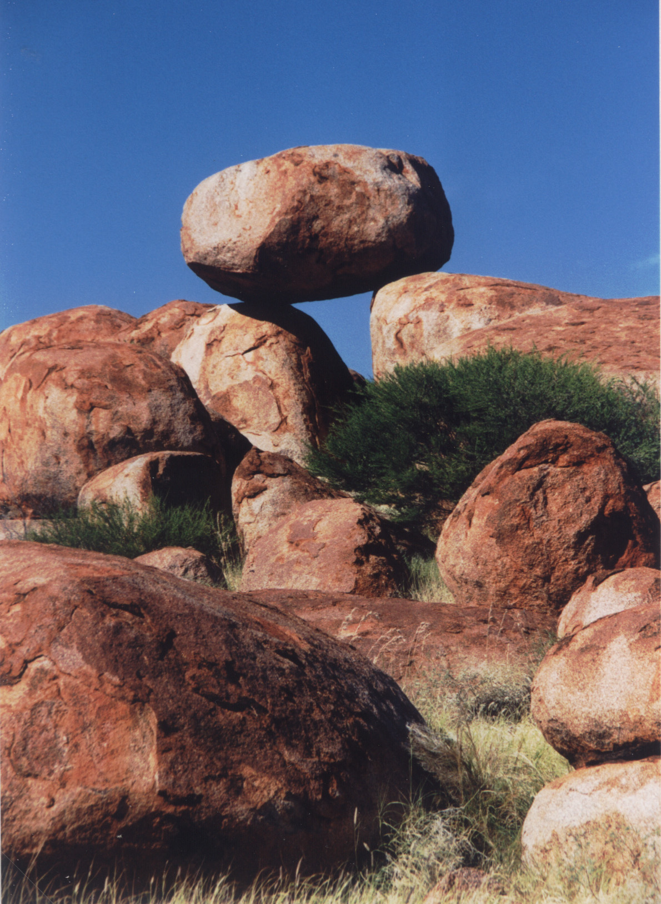{width="50%" fig-align="center"}


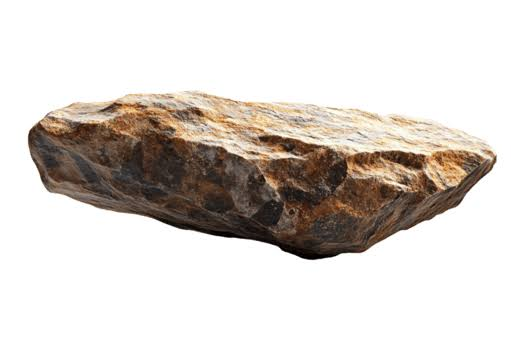{fig-align="center"}

:::

## Composição do solo
<hr>

[__Classificação de diâmetro das partículas__]{.fg style="--col: #e64173"}

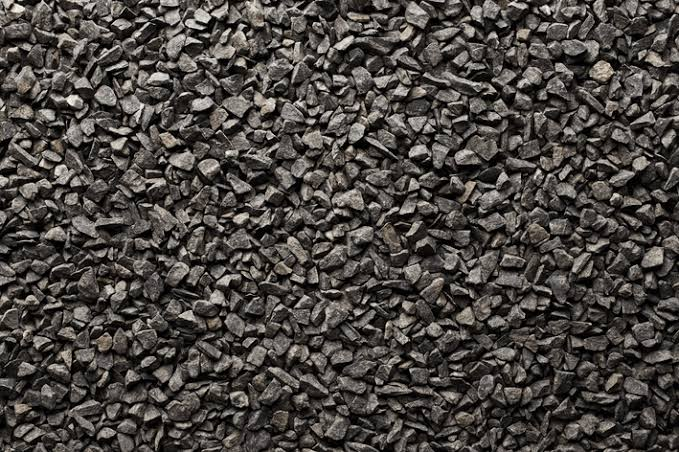{fig-align="center"}

## Composição do solo
<hr>

[__Classificação de diâmetro das partículas__]{.fg style="--col: #e64173"}

```{mermaid}

flowchart TD

    A["<b>Fase sólida do solo</b>"]

    A --> B["Areia<br><b>2000–53 µm</b>"]
    A --> C["Silte<br><b>53–2 µm</b>"]
    A --> D["Argila<br><b>&lt; 2 µm</b>"]

    D --> E["Mineral"]
    D --> F["Orgânica"]

    E --> G["Argilominerais"]
    G --> H["Minerais 2:1"]
    G --> I["Minerais 1:1"]

    E --> J["Óxidos"]
    J --> K["Óxidos de ferro"]
    J --> L["Óxidos de alumínio"]

    style A fill:#000,color:#fff,stroke:#000
    style B fill:#000,color:#fff,stroke:#000
    style C fill:#000,color:#fff,stroke:#000
    style D fill:#000,color:#fff,stroke:#000
    style E fill:#000,color:#fff,stroke:#000
    style F fill:#000,color:#fff,stroke:#000
    style G fill:#000,color:#fff,stroke:#000
    style H fill:#000,color:#fff,stroke:#000
    style I fill:#000,color:#fff,stroke:#000
    style J fill:#000,color:#fff,stroke:#000
    style K fill:#000,color:#fff,stroke:#000
    style L fill:#000,color:#fff,stroke:#000
```

# Minerais do solo

## Minerais do solo
<hr>

Composição da crosta terrestre (Massa)

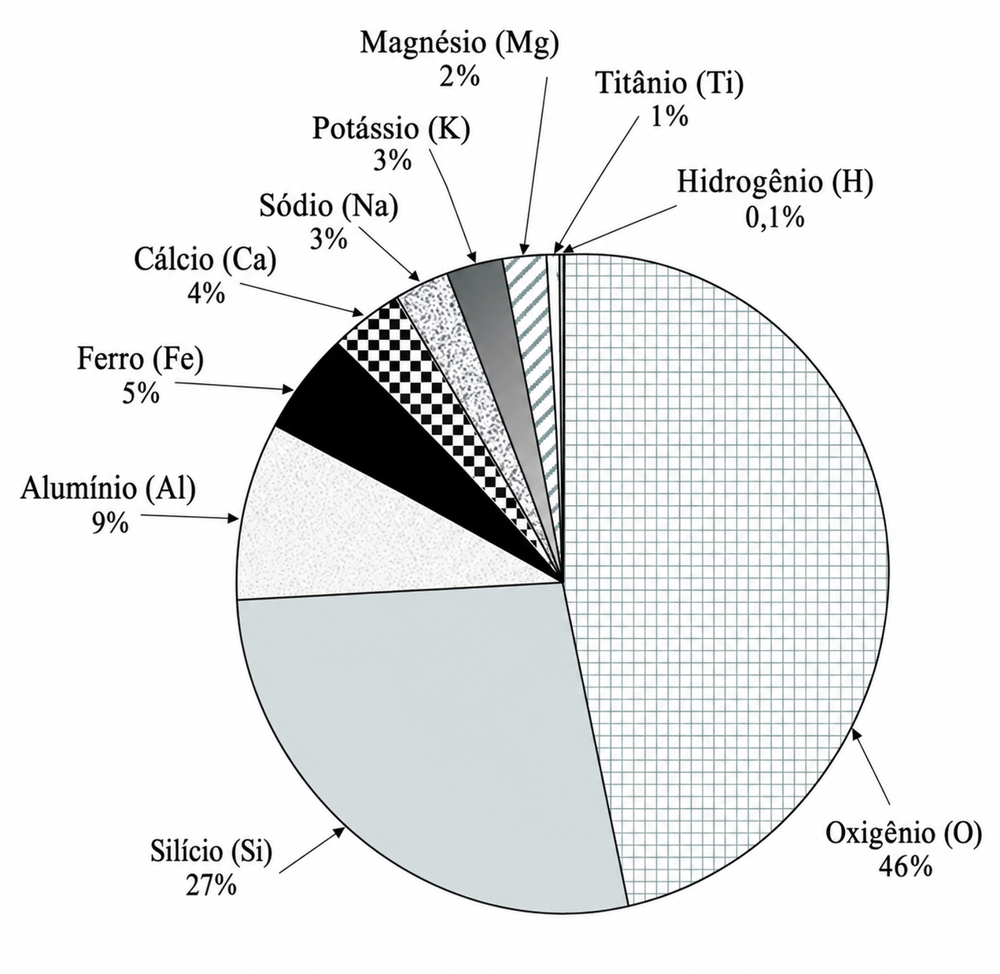{fig-align="center"}

## Minerais do solo
<hr>

Respeitando regras, ânions de oxigênio se organizam em torno de cátions centrais (Si, Al e Fe). São formados os tetraedros e os octaedros.

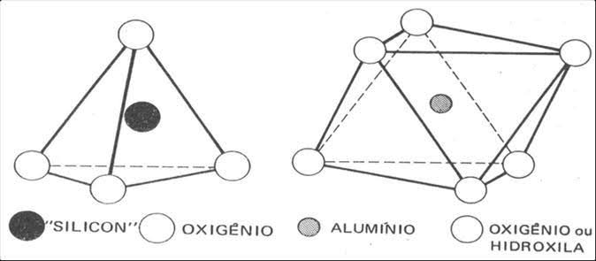{width="300px"}


## Minerais do solo
<hr>


::: {.fragment}

[__Minerais primários__]{.fg style="--col: #e64173"}

Não alterado quimicamente desde sua deposição e cristalização da lava derretida.

:::


::: {.fragment}

[__Minerais secundários__]{.fg style="--col: #e64173"}

Resulta da intemperização dos minerais primários.

:::


## Minerais do solo
<hr>

::: {layout-ncol="3"}

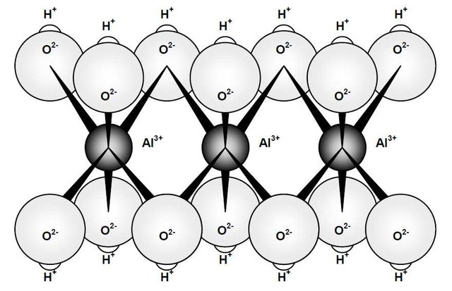{fig-align="center"}

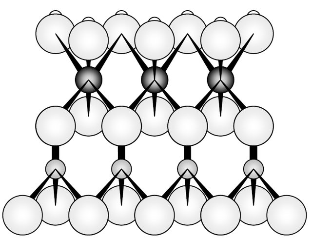{fig-align="center"}

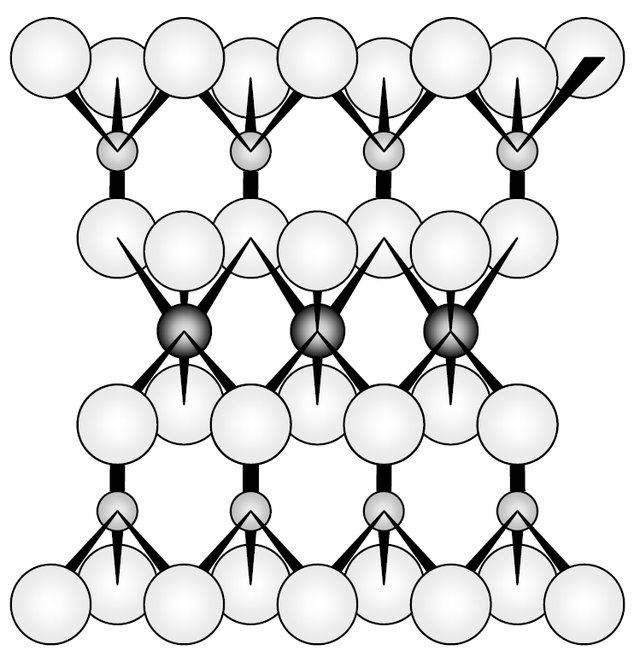{fig-align="center"}

:::

# Textura do solo

## Textura do solo
<hr>

É a característica do solo que diz respeito as proporções relativas das frações areia, silte e argila do solo. Essas frações são advindas da fração geral chamada **Terra Fina**.


::: {.fragment}

A textura refere-se à sensação que a amostra oferece ao tato.

:::

::: {.fragment}

A textura é a forma de determinar a granulometria do solo (distribuição do tamanho das partículas).

:::


## Textura do solo
<hr>

::: {.fragment}

**Terra fina seca ao ar** (TFSA) é a fração do solo menor que 2 mm.

:::

::: {.fragment}

Interações mecânicas, físicas, biológicas e químicas

:::

## Textura do solo
<hr>

[__Tamanho das partículas__]{.fg style="--col: #e64173"}

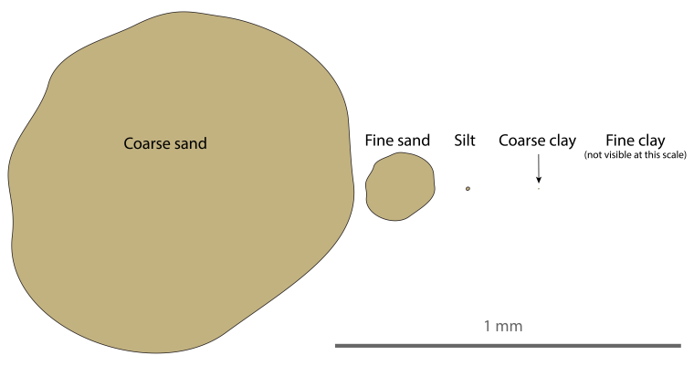{fig-align="center"}

## Textura do solo
<hr>

[__Minerais por fração__]{.fg style="--col: #e64173"}

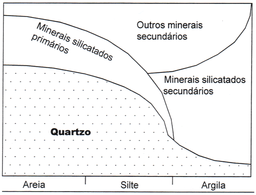{fig-align="center"}


## Textura do solo
<hr>

[__Tamanho das partículas__]{.fg style="--col: #e64173"}

| Propriedade | Areia | Silte | Argila |
|:------------|:-----:|:-----:|:------:|
| **Forma** | Denteada | Ligeiramente irregular | Lâminas/tubos |
| **Sensação** | Aspereza | Suave/talco | Pegajoso |
| **Plasticidade** | Não plástica | Ligeiramente plástica | Plástica |
| **Coesão** | Não coesiva | Ligeiramente coesiva | Coesiva/gelatinosa |
| **Área superficial** | Muito baixa | Moderada | Muito alta |
| **Capacidade de retenção de água** | Ausente/pouca | Moderada | Muito alta |
| **CTC** | Ausente | Muito baixa | Alta ou muito alta |
| **Mineralogia** | minerais primários | minerais primários | minerais secundários |

# Determinação da textura

## Determinação da textura
<hr>

Duas formas: no campo e no laboratório

## Determinação da textura
<hr>

[__No campo__]{.fg style="--col: #e64173"}

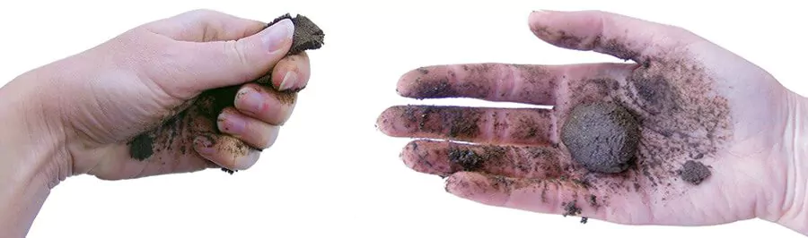

## Determinação da textura
<hr>

[__No campo__]{.fg style="--col: #e64173"}

::: {.incremental}

- Baseado na correlação entre a sensibilidade ao tato com o tamanho e distribuição das partículas unitárias do solo;

- Areia: Sensação de atrito (aspereza).
  - Solta em grão simples, não-plastica, não-pegajosa, não-deformada.

- Silte: Sensação sedosa.
  - Ligeira coesão quando seca.

- Argila: Sensação de pegajosidade e de plasticidade.
  - Muito pegajosa quando úmida, dura e muito coesa quando seca.

- **Atenção!** É uma avaliação muito subjetiva e ligada a experiência da pessoa.

:::

## Determinação da textura
<hr>

[__No laboratório__]{.fg style="--col: #e64173"}

Obtenção da TFSA:

::: {layout-ncol="5"}

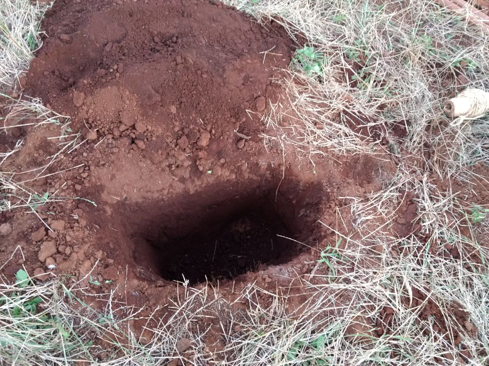

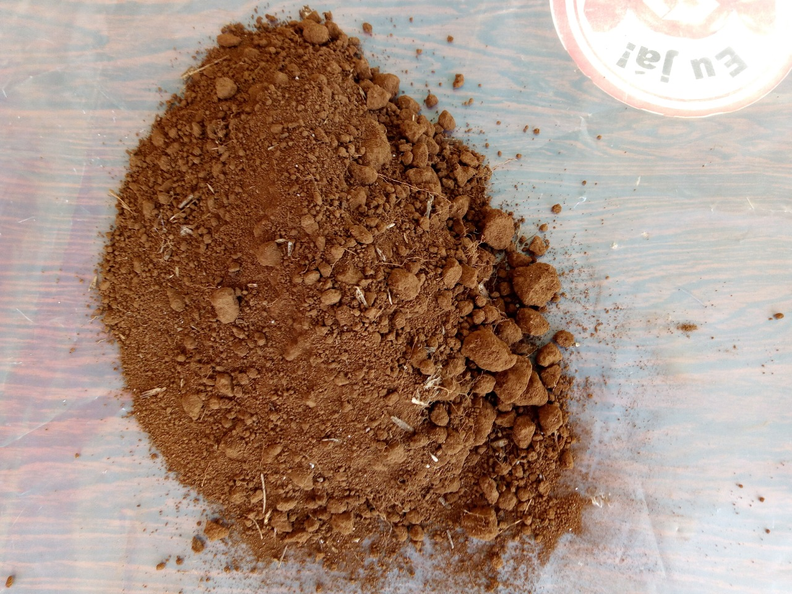

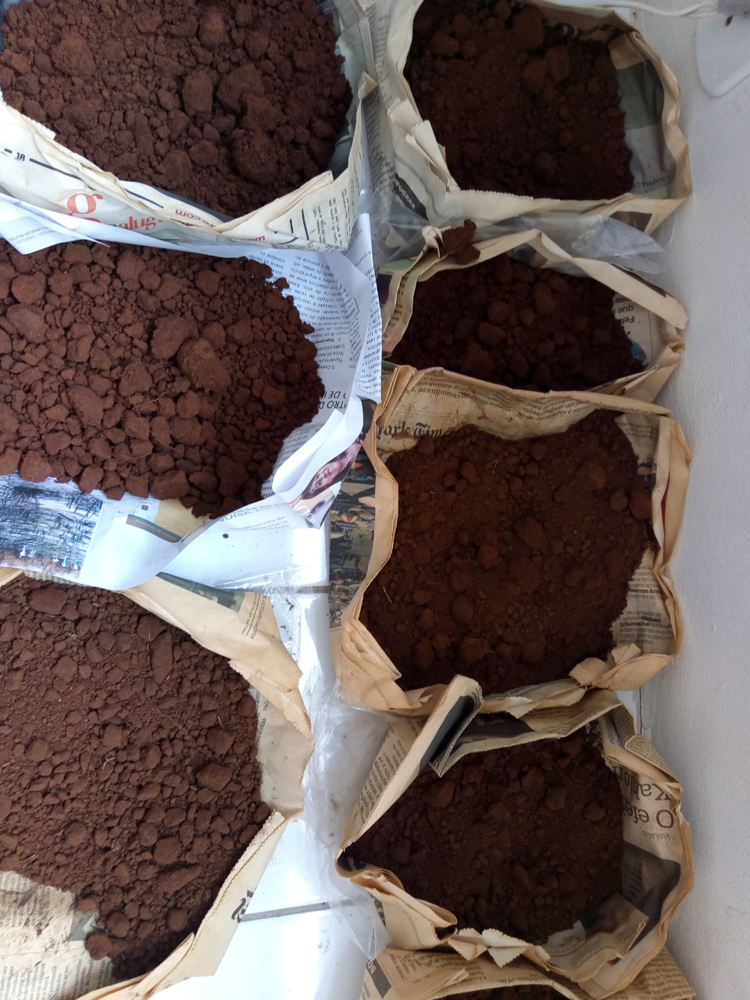

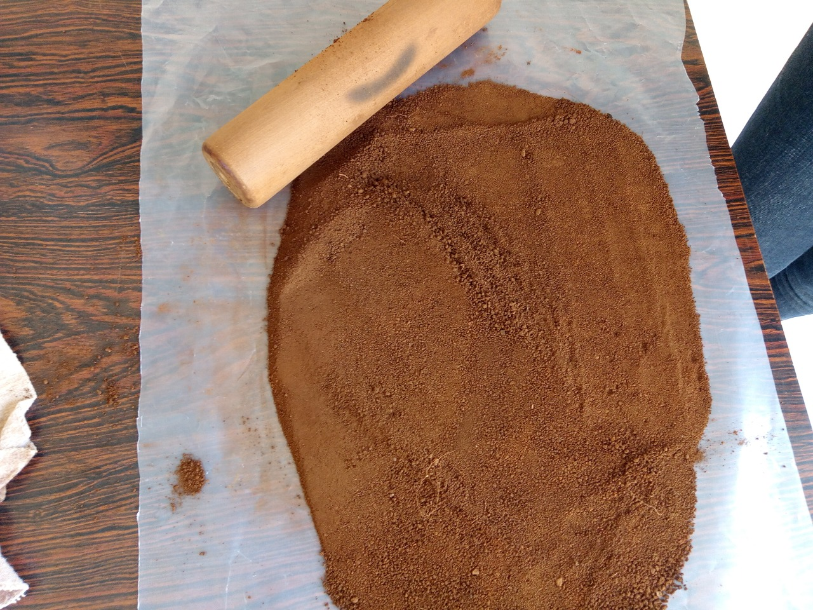

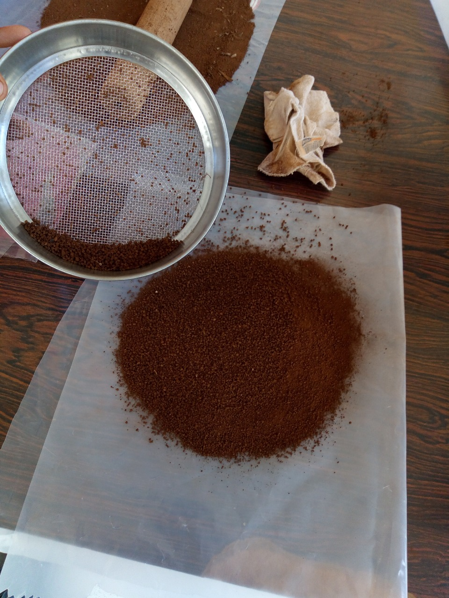

:::

## Determinação da textura
<hr>

[__No laboratório__]{.fg style="--col: #e64173"}

Etapas:

::: {.incremental}

- Pré-tratamento;

- Dispersão;

- Separação das frações do solo.

:::

## Determinação da textura
<hr>

[__No laboratório__]{.fg style="--col: #e64173"}

Pré-tratamentos:

::: {.incremental}

- Remoção da matéria orgânica via oxidação com peróxido de hidrogênio;

- Remoção dos óxidos de ferro e alumínio*;

- Remoção de carbonados por meio de tratamento com ácidos (HCl);

- Remoção de sais solúveis por meio de lixiviação (diálise).

:::


::: {.fragment}

Solos do Brasil, de forma geral, é removido apenas a matéria orgânica. 

:::

## Determinação da textura
<hr>

[__No laboratório__]{.fg style="--col: #e64173"}

Dispersão:

::: {.incremental}

- Finalidade de destruir os agregados do solo, transformando-os em partículas individualizadas.

- Dispersão física e química.
  - Dispersão física por meio de agitação mecânica.
  - Dispersão química por meio de produto químico (NaOH 1 mol).

- Dispersão física por meio de agitação horizontal (choque de partículas).

- Dispersão química por meio do aumento da espessura da dupla camada difusa das partículas de argila com cátions monovalentes com hidratação. A mudança do pH também altera o balanço eletroquímico do meio (aumento de cargas negativas).

:::

## Determinação da textura
<hr>

[__No laboratório__]{.fg style="--col: #e64173"}

Dispersão:

::: {layout-ncol="3"}

{width="30%"}

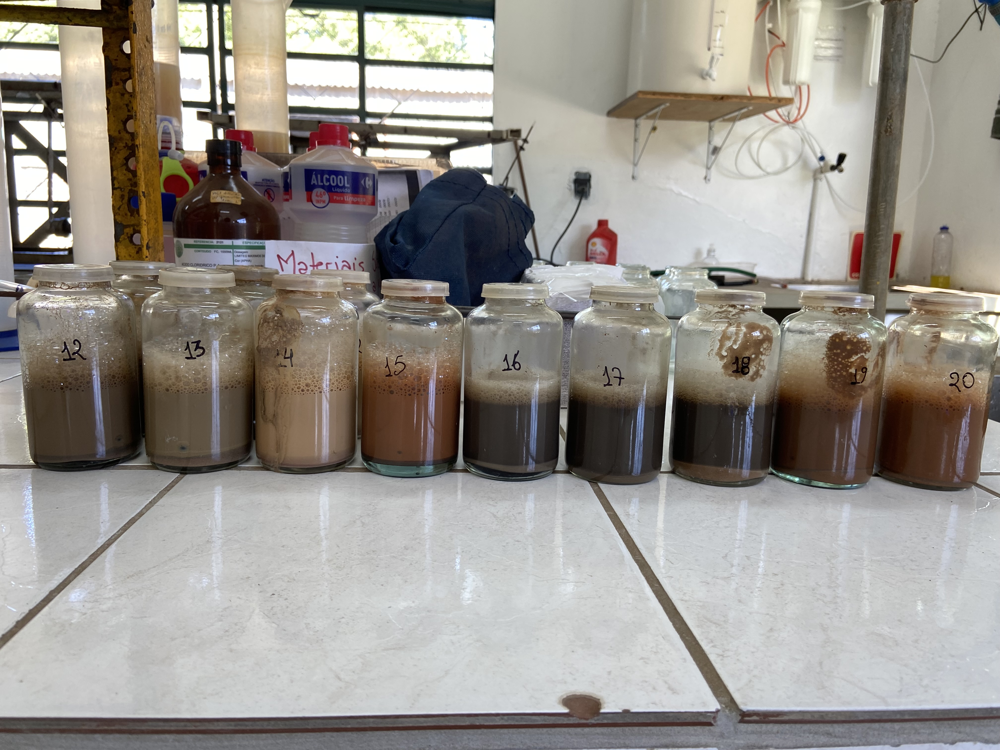{width="60%"}

:::

## Determinação da textura
<hr>

[__No laboratório__]{.fg style="--col: #e64173"}

Dispersão:

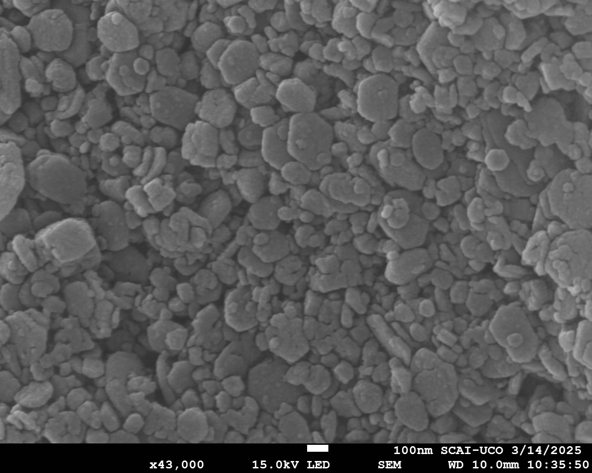{fig-align="center"}


## Determinação da textura
<hr>

[__No laboratório__]{.fg style="--col: #e64173"}

Separação das frações:

::: {.incremental}

- A fração areia é removida por meio de peneiramento úmido (peneira com malha de 0,053 mm);

- Toda a amostra é lavada para remover a argila e o silte da peneira e reter apenas a areia;

- Todo conteúdo é armazenado em uma proveta com volume de 1 L (não pode ultrapassar).

- A determinação do silte e da argila ocorre por sedimentação.

::: 

## Determinação da textura
<hr>

[__No laboratório__]{.fg style="--col: #e64173"}

Separação das frações:

::: {layout-ncol="3"}

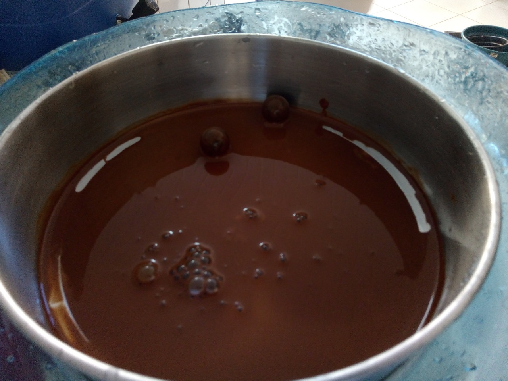{width="40%"}

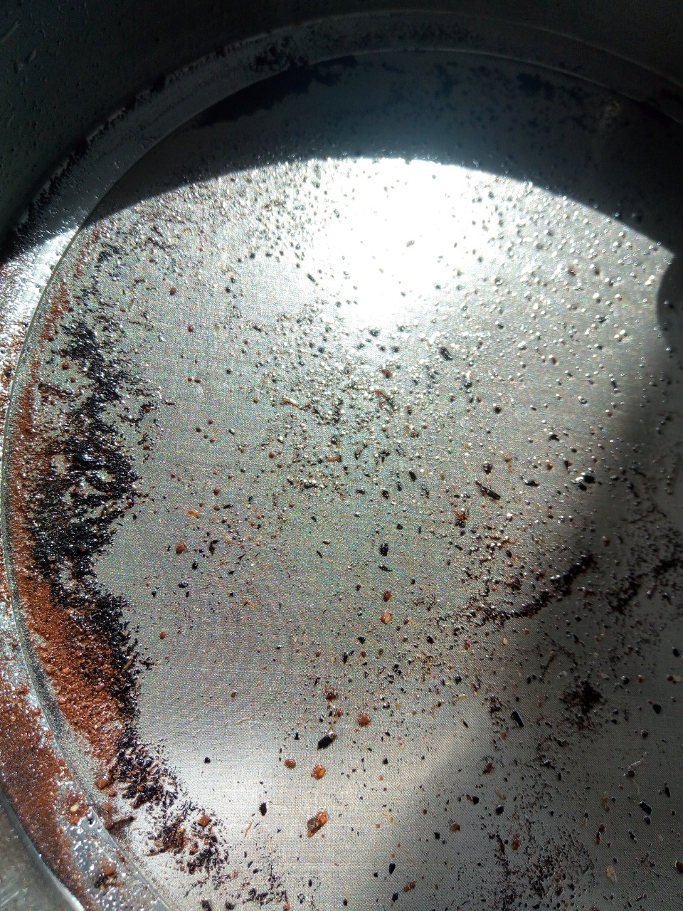{width="40%"}

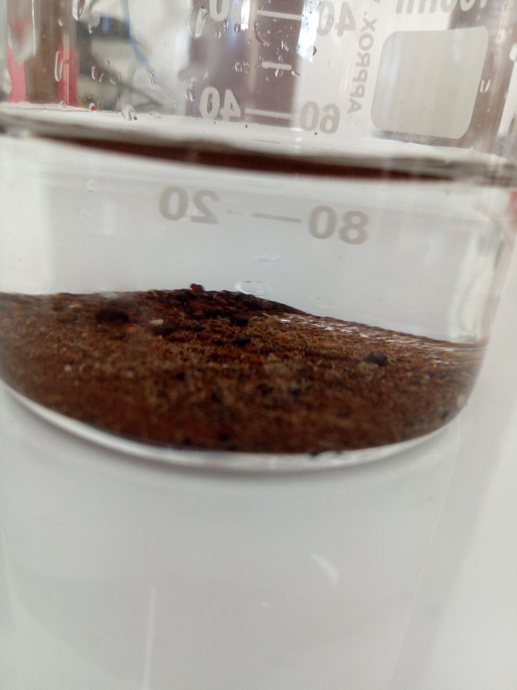{width="40%"}

:::

## Determinação da textura
<hr>

[__No laboratório__]{.fg style="--col: #e64173"}

Separação das frações:

::: {layout-ncol="2"}

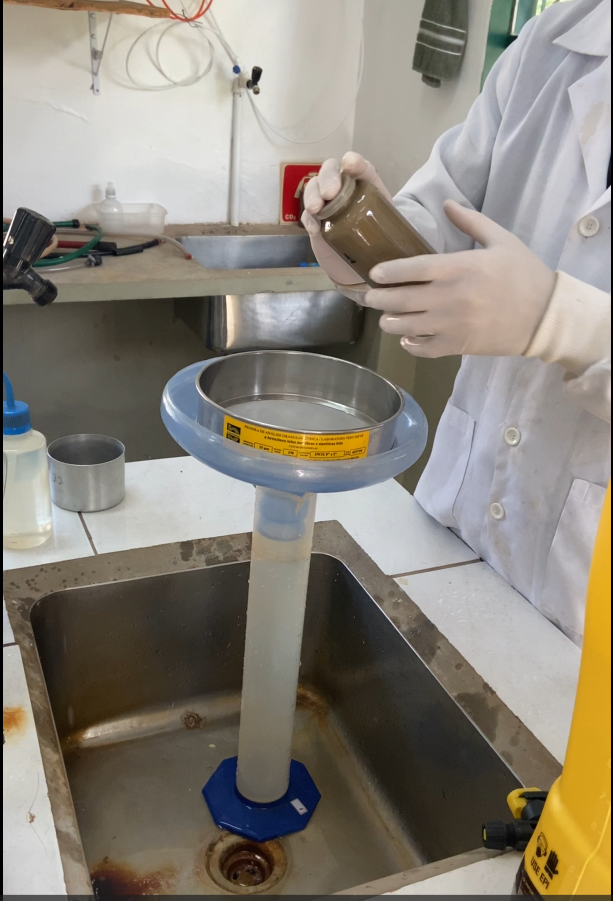{width="280px"}

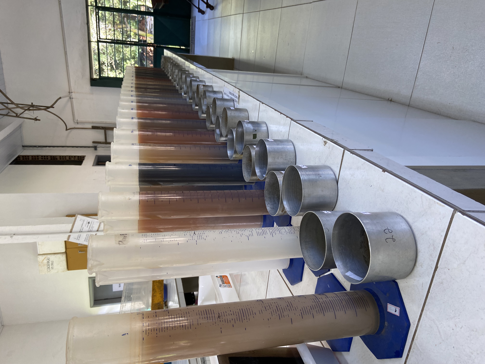{width="300px"}

:::

## Determinação da textura
<hr>

[__No laboratório__]{.fg style="--col: #e64173"}

A determinação do teor de argila é baseada no tempo necessário para que uma quantidade (cm) da solução da proveta contenha apenas argila.


::: {.fragment}

Isso está relacionado com a lei de Stokes: 

> A velocidade de queda (sedimentação) de um material sólido no líquido ocorre de acordo com o seu diãmetro (esférico) e a viscosidade do líquido

:::

## Determinação da textura
<hr>

[__Lei de Stokes__]{.fg style="--col: #e64173"}


$$
\vec{F} = -6\pi r\eta\vec{v}
$$

onde:

- $\vec{F}$ é a força de fricção;
- $r$ é o raio de Stokes da partícula;
- $\eta$ é a viscosidade do fluido; e
- $\vec{v}$ é a velocidade da partícula.

## Determinação da textura
<hr>

[__Lei de Stokes__]{.fg style="--col: #e64173"}

$$
V_s = \frac{2}{9}\frac{r^2 g(\rho_p-\rho_f)}{\eta}
$$

**onde:**

- $V_s$ é a velocidade de sedimentação das partículas (velocidade limite);
- $g$ é a aceleração da gravidade;
- $r$ é o raio de Stokes da partícula;
- $\rho_p$ é a densidade das partículas;
- $\eta$ é a viscosidade do fluido; 
- $\rho_f$ é a densidade do fluido.


## Determinação da textura
<hr>

[__Lei de Stokes__]{.fg style="--col: #e64173"}

$$
t = \frac{18~\eta~h}{g(\rho_s-\rho_l)\phi^2}
$$


- $t$ é o tempo de queda (s);
- $h$ é altura da queda (cm) - 10 ou 5 cm desde a superfície da solução;
- $\eta$ é a viscosidade da água (g/cm/s) - 0,008007 (20ºC);
- $g$ é a aceleração da gravidade (cm/s^2^) - 980;
- $\rho_s$ é a viscosidade do sólido (cm/cm^3^) - 2,65; 
- $\rho_l$ é a densidade do líquido (g/cm^3^) - 0,99949 (20ºC);
- $\phi^2$ é o diâmetro da partícula (cm) - 0,0002

## Determinação da textura
<hr>

[__Lei de Stokes exemplo__]{.fg style="--col: #e64173"}

Qual é o tempo de queda necessário para obter apenas partículas de tamanho argila a uma profundidade de 5 cm?


::: {.fragment}

$$
t = \frac{18* 0,008007*5}{980*(2,65-0,099949)*0,0002^2}
$$

:::


::: {.fragment}

$t = 11138,02~s$ ou $t = 3.09~h$

:::


## Determinação da textura
<hr>

Exemplo de sedimentação das partículas

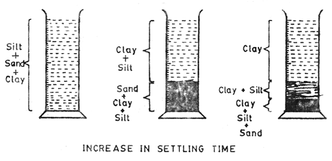{fig-align="center"}

## Determinação da textura
<hr>

[__Método do hidrômetro ou densímetro__]{.fg style="--col: #e64173"}

::: {.incremental}

- Proposto por Bouyoucos em 1927 é baseado na densidade da solução (silte + argila);

- Relaciona as densidades com o tempo de leitura e com a temperatura;

- Resultados em g L^-1^;

- Método rápido, mas menos preciso.

:::

## Determinação da textura
<hr>

[__Método do densímetro__]{.fg style="--col: #e64173"}

::: {layout-ncol="2"}

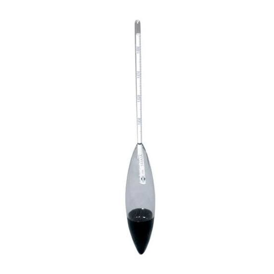{width="280px"}

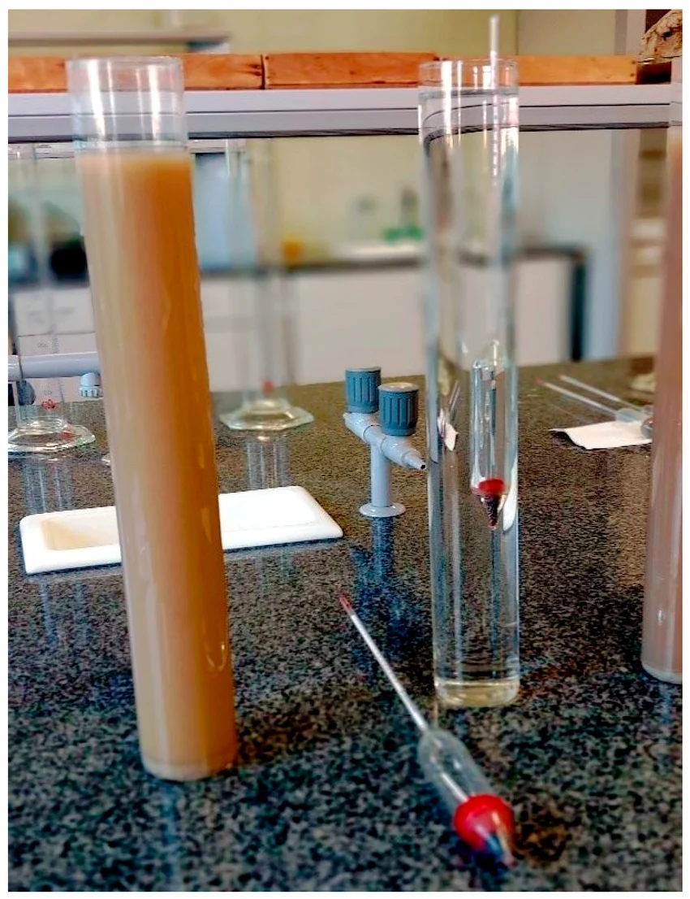{width="300px"}

:::

## Determinação da textura
<hr>

[__Método do densímetro__]{.fg style="--col: #e64173"}

::: {.incremental}

- 50g de TFSA são dispersas de forma mecânica e química;
  - 250 ml de água mais 10 ml de NaOH 1 mol L^-1^;

- Contéudo transferido para proveta de 1 L;

- Agitação por 40 s;

- Imediatamente após a agitação o densímetro de Bouyoucos é adicionado;

- Leitura é realizada após 40 s (argila + silte);

- Após 1 hora e meia é realizada uma segunda medição (apenas argila).

:::


## Determinação da textura
<hr>

[__Método da pipeta__]{.fg style="--col: #e64173"}

::: {.incremental}

- Desenvolvido em 1922 é adequado para a determinação da fração argila;

- Utiliza-se de uma pipeta para coletar uma alíquota da suspensão a profundidade e tempo determinados;

- Método mais lento, mas mais preciso;

:::

## Determinação da textura
<hr>

[__Método da pipeta__]{.fg style="--col: #e64173"}

::: {layout-ncol="2"}

{width="300px"}

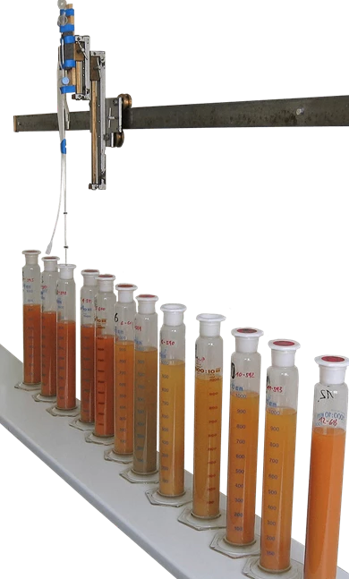{width="300px"}

:::

## Determinação da textura
<hr>

[__Método da pipeta__]{.fg style="--col: #e64173"}

::: {.incremental}

- 20 g de TFSA com 100 ml de água e 10 ml de NaOH 1 mol L^-1^;

- Agitar por 16 horas a 50 rpm;

- Remover a areia por peneiramento;

- Agitação a suspensão por 1 minuto de forma vigorosa;

- Mediar a temperatura e calcular o tempo de sedimentação para 5 cm;

- Após a sedimentação coletar 50 ml da suspensão com pipeta em profundidade de 5 cm;

- Deixar secar em estufa e calcular o peso dos recipientes de areia e de argila.

:::

## Determinação da textura
<hr>

[__No laboratório__]{.fg style="--col: #e64173"}

Separação das frações:

::: {layout-ncol="3"}

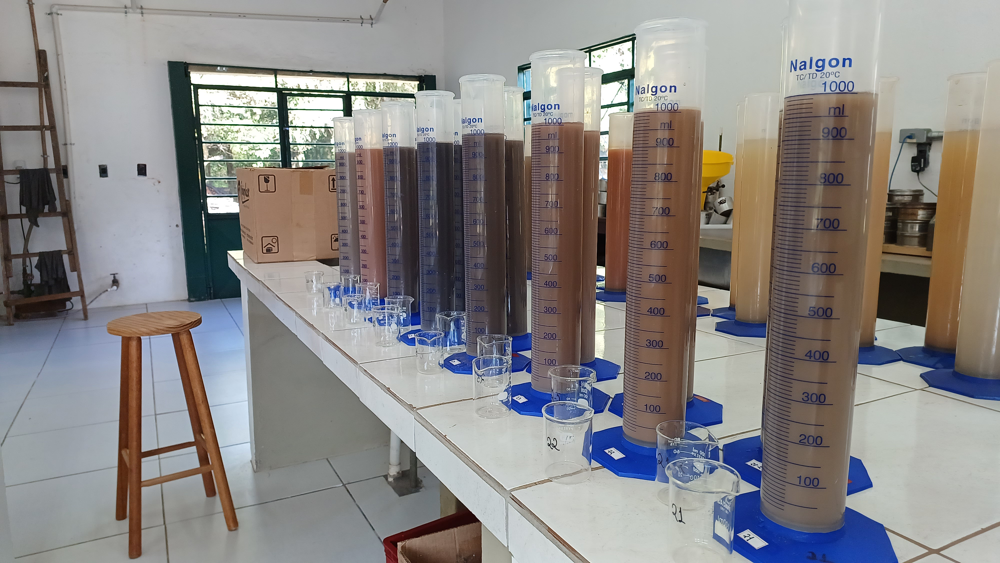{width="40%"}

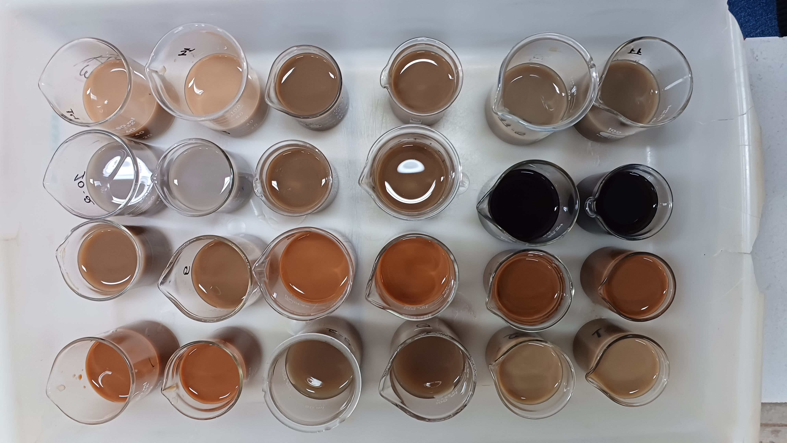{width="40%"}

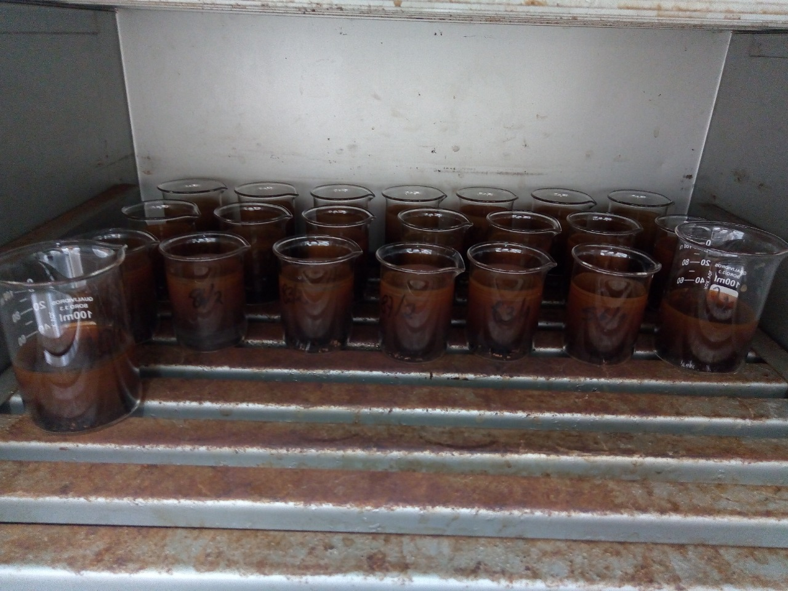{width="40%"}

:::


## Determinação da textura
<hr>

Zonas de amostragem dos diferentes métodos

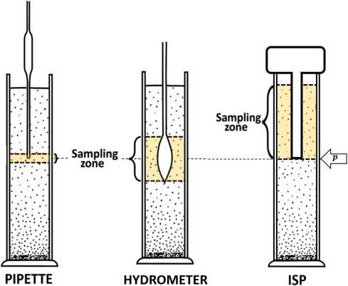{fig-align="center"}


## Determinação da textura
<hr>

Ex: Em 20 g de TFSA, 7 g de areia foram retidas na peneira. Após determinação do tempo, 50 ml da suspensão foi coletada a 5 cm de profundidade, coloca em recipiente e pesada, totalizando 0,548 g.


::: {.fragment}

- Areia: 350 g kg^-1^
- Argila: 548 g kg^-1^
- Silte: ???

:::

## Determinação da textura
<hr>

Triângulo textural (A + S + Ar = 100%)

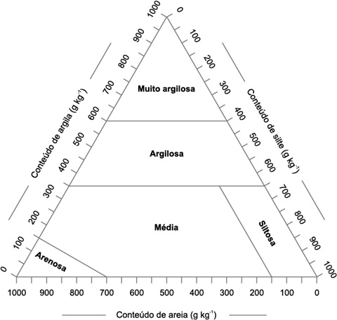{fig-align="center"}

## Determinação da textura
<hr>

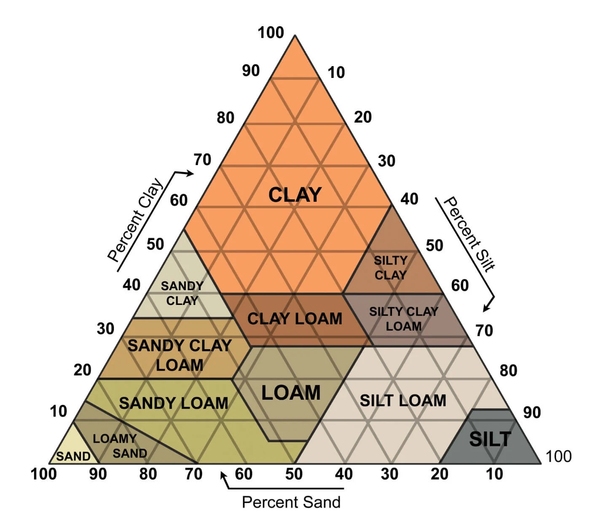{fig-align="center"}

## Determinação da textura
<hr>

Exemplo:

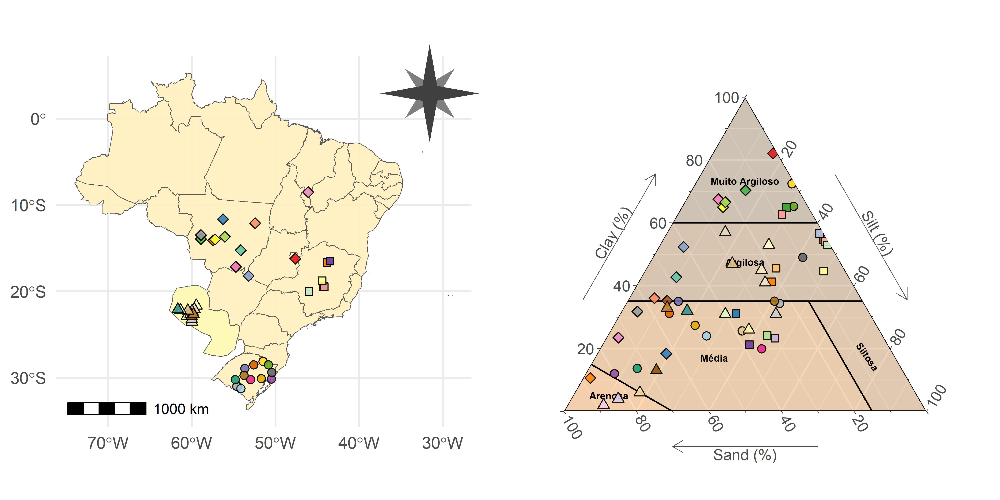

# Importância da textura

## Importância da textura
<hr>

::: {.incremental}

- Valor da terra e exploração de uso (agrícola, descartes).

- Em classificação do solo, às vezes é a primeira e mais importante característica a ser determinada.

- Zoneamento agrícola e de risco climático.

:::

## Importância da textura
<hr>

::: {.small}

| Propriedades no solo | Argiloso | Arenoso |
|:---------------------|:--------:|:-------:|
| Retenção de água | Alta | Baixa |
| Movimentação de água no perfil | Difícil | Fácil |
| Coesão | Elevada | Baixa |
| Densidade | Menor | Maior |
| Porosidade total | Maior | Menor |
| Microporosidade | Maior | Menor |
| Superfície específica | Elevada | Baixa |
| Estruturação | Bem estruturado | Sem estrutura |
| CTC | Alta | Baixa |
| Dificuldade de preparo | Maior | Menor |
| Amplitude térmica | Menor | Maior |

::: 

# Fim!