# Estrutura e agregação do solo

## Estrutura e agregação do solo 
<hr>

[__O que é estrutura?__]{.fg style="--col: #e64173"}

::: {.fragment}

> Estrutura do solo se refere ao arranjo das partículas e do espaço poroso entre elas, abrangendo a forma, o tamanho e a organização dos agregados ou unidades estruturais.

:::

::: {.fragment}

> Estrutura é o arranjamento e a organização das partículas do solo - Hillel (1980).

:::

## Estrutura e agregação do solo 
<hr>

[__O que são os agregados?__]{.fg style="--col: #e64173"}

::: {.fragment}

> Agregados ou unidades estruturais, são porções de solo nas quais as partículas estão dispostas obedecendo mais ou menos um padrão de organização.

:::

## Estrutura e agregação do solo
<hr>

[__O que são os agregados?__]{.fg style="--col: #e64173"}

::: {.incremental}

- Em um agregado, as partículas minerais (areia, silte e argila) e orgânicas e íons estão ligados entre si com mais força do que a força que existe entre as superfícies de agregados vizinhos em contato.

- A interface que delimita os agregados é chamada de **superfície de fraqueza**.

- Muitas vezes visíveis a olho nu.
  - Fratura por contração (secamento do solo).

:::

## Estrutura e agregação do solo
<hr>

[__Formato, tamanho e resistência:__]{.fg style="--col: #e64173"}

::: {.incremental}

- Granulometria;
- Composição química;
- Composição mineralógica;
- Atividade biológica do solo.

:::

# Gênese da estrutura do solo

## Gênese da estrutura do solo
<hr>

A formação dos agregados é um processo de união de partículas do solo (minerais e orgânicas).

::: {.incremental}

- Forças para aproximar as partículas;
- Agentes ligantes (cimentantes) para estabilizar os agregados.

- Processos: físicos, químicos e biológicos.

:::


::: {.fragment}

Há um agrupamento, uma hierarquia nos agregados.

:::


## Gênese da estrutura do solo
<hr>

[__Agentes ligantes e cimentantes:__]{.fg style="--col: #e64173"}


::: {.fragment}

São responsáveis pela **cimentação** das partículas.

:::

::: {.incremental}

- Mineral: íons, carbonatos, óxidos e aluminossilicatos;
- Orgânicos: atividade biológica das raízes e dos organismos.

- Classificação (tempo):
  - Transientes;
  - Temporários;
  - Persistentes.

:::

## Gênese da estrutura do solo
<hr>

[__Agentes ligantes e cimentantes:__]{.fg style="--col: #e64173"}

```{dot}
//| fig-width: 10
//| fig-height: 5
//| fig-align: center

digraph {

    graph [
        rankdir=TB
        bgcolor="transparent"
        fontname="Arial"
        nodesep=0.45
        ranksep=0.35
        pad=0.05
        margin=0
        splines=ortho
        outputorder=edgesfirst
    ]

    node [
        shape=box
        style="rounded,filled"
        fontname="Arial"
        fontsize=18
        fontcolor="#263238"
        fillcolor="#F7F7F7"
        color="#7F8C8D"
        penwidth=1.2
        margin="0.16,0.08"
    ]

    edge [
        color="#607D8B"
        penwidth=1.2
        arrowsize=0.6
    ]

    # -----------------------------------------------------------------
    # NÓ PRINCIPAL
    # -----------------------------------------------------------------

    A [
        label="Agentes de ligação"
        fillcolor="#E9EEF2"
        color="#607D8B"
        penwidth=1.5
        fontsize=20
    ]

    # -----------------------------------------------------------------
    # PRIMEIRA DIVISÃO
    # -----------------------------------------------------------------

    B [
        label="Orgânicos"
        fillcolor="#EEF5F8"
        color="#7FA6B8"
    ]

    C [
        label="Inorgânicos"
        fillcolor="#F2F2F2"
        color="#A6A6A6"
    ]

    # -----------------------------------------------------------------
    # SUBDIVISÕES DOS AGENTES ORGÂNICOS
    # -----------------------------------------------------------------

    D [
        label="Transitórios"
        fillcolor="#F8FBFC"
        color="#A5C2CF"
    ]

    E [
        label="Temporários"
        fillcolor="#F8FBFC"
        color="#A5C2CF"
    ]

    F [
        label="Persistentes"
        fillcolor="#F8FBFC"
        color="#A5C2CF"
    ]

    # -----------------------------------------------------------------
    # DESCRIÇÕES
    # -----------------------------------------------------------------

    D_desc [
        shape=plaintext
        label="• Polissacarídeos\n• Produtos microbianos"
        fontsize=15
        fontcolor="#37474F"
    ]

    E_desc [
        shape=plaintext
        label="• Raízes\n• Hifas fúngicas\n• Subprodutos microbianos"
        fontsize=15
        fontcolor="#37474F"
    ]

    F_desc [
        shape=plaintext
        label="• Substâncias húmicas\n• Complexos organominerais\n• Materiais húmicos\n  desidratados\n• Complexos de sesquióxidos"
        fontsize=15
        fontcolor="#37474F"
    ]

    C_desc [
        shape=plaintext
        label="• Carbonatos\n• Sesquióxidos\n• Aluminosilicatos\n• Silicatos desidratados"
        fontsize=15
        fontcolor="#37474F"
    ]

    # -----------------------------------------------------------------
    # ALINHAMENTO
    # -----------------------------------------------------------------

    { rank=same; B; C }

    { rank=same; D; E; F }

    { rank=same; D_desc; E_desc; F_desc; C_desc }

    # -----------------------------------------------------------------
    # CONEXÕES
    # -----------------------------------------------------------------

    A -> B
    A -> C

    B -> D
    B -> E
    B -> F

    D -> D_desc [
        arrowhead=none
        color="#B0BEC5"
    ]

    E -> E_desc [
        arrowhead=none
        color="#B0BEC5"
    ]

    F -> F_desc [
        arrowhead=none
        color="#B0BEC5"
    ]

    C -> C_desc [
        arrowhead=none
        color="#B0BEC5"
    ]
}
```

## Gênese da estrutura do solo
<hr>

[__Agentes ligantes e cimentantes:__]{.fg style="--col: #e64173"}

::: {.incremental}

- Transientes: materiais orgânicos frescos com decomposição muito rápida;
  - Associados à formação de agregados grandes e estáveis ($250~\mathrm{\mu m}$ de diâmetro);
- Temporários: raízes, hifas dos fungos e bioprodutos microbianos;
  - Raízes laterais finas atuam na união de microagregados por meio dos pelos radiculares e por exsudatos;
  - Efeitos podem durar meses e até anos.

:::

## Gênese da estrutura do solo
<hr>

[__Agentes ligantes e cimentantes:__]{.fg style="--col: #e64173"}

::: {.incremental}

- Persistentes: alta estabilidade dos microagregados;
  - Polímeros fortemente adsorvidos (complexo organomineral);
  - Ácidos húmicos e fúlvicos associados com ferro amorfo;
  - Alumínio e aluminossilicatos.

:::

## Gênese da estrutura do solo
<hr>

[__Processos químicos:__]{.fg style="--col: #e64173"}

::: {.incremental}

- Interação de argilas, óxidos, moléculas orgânicas e íons.
  - Floculação, expansão e contração do solo e ciclos de secagem e umedecimento (**Aproximação de partículas**).

:::

## Gênese da estrutura do solo
<hr>

[__Floculação da argila:__]{.fg style="--col: #e64173"}

::: {layout-ncol="2"}

<!-- {width="280px"} -->

<!-- {width="280px"} -->

:::

## Gênese da estrutura do solo
<hr>

[__Ponte entre argila e cátions:__]{.fg style="--col: #e64173"}

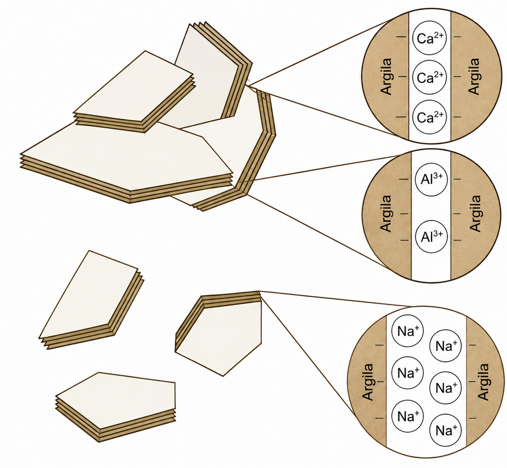{fig-align="center"}


## Gênese da estrutura do solo
<hr>

[__Ponte entre argila e cátions polivalentes:__]{.fg style="--col: #e64173"}

```{dot}
//| fig-width: 10
//| fig-height: 5
//| fig-align: center

graph {

    graph [
        layout=neato
        bgcolor="transparent"
        overlap=false
        splines=line
        outputorder=edgesfirst
        pad=0.2
        margin=0
    ]

    node [
        fontname="Arial"
        fontsize=18
    ]

    edge [
        color="#333333"
        penwidth=1.2
    ]


    # =========================================================
    # NÓ CENTRAL
    # =========================================================

    clay0 [
        label="Argila"
        shape=box
        style="filled"
        fillcolor="#F7F7F7"
        color="#333333"
        penwidth=1.2
        margin="0.15,0.10"
        pos="0,0!"
    ]


    # =========================================================
    # LIGAÇÃO SUPERIOR
    #
    # Argila
    #   |
    #  Mg
    #   |
    #  OH
    #   |
    #  Mg
    #   |
    # Argila central
    # =========================================================

    mg_top1 [
        label="Mg"
        shape=plaintext
        pos="0,1!"
    ]

    oh_top [
        label="OH"
        shape=plaintext
        pos="0,2!"
    ]

    mg_top2 [
        label="Mg"
        shape=plaintext
        pos="0,3!"
    ]

    clay_top [
        label="Argila"
        shape=box
        style="filled"
        fillcolor="#F7F7F7"
        color="#333333"
        penwidth=1.2
        pos="0,4!"
    ]

    clay0 -- mg_top1 -- oh_top -- mg_top2 -- clay_top


    # =========================================================
    # LIGAÇÃO À ESQUERDA
    #
    # Argila — Be — OH — Be — Argila central
    # =========================================================

    be_left1 [
        label="Be"
        shape=plaintext
        pos="-1.3,0!"
    ]

    oh_left [
        label="OH"
        shape=plaintext
        pos="-2.5,0!"
    ]

    be_left2 [
        label="Be"
        shape=plaintext
        pos="-3.7,0!"
    ]

    clay_left [
        label="Argila"
        shape=box
        style="filled"
        fillcolor="#F7F7F7"
        color="#333333"
        penwidth=1.2
        pos="-5,0!"
    ]

    clay0 -- be_left1 -- oh_left -- be_left2 -- clay_left


    # =========================================================
    # LIGAÇÕES À DIREITA
    #
    #              OH — Fe — Argila
    #             /
    # Argila — Fe
    #             \
    #              OH — Fe — Argila
    # =========================================================

    fe_center [
        label="Fe"
        shape=plaintext
        pos="1.3,0!"
    ]

    clay0 -- fe_center


    # RAMO SUPERIOR

    oh_ru [
        label="OH"
        shape=plaintext
        pos="2.4,1.0!"
    ]

    fe_ru [
        label="Fe"
        shape=plaintext
        pos="3.6,1.0!"
    ]

    clay_ru [
        label="Argila"
        shape=box
        style="filled"
        fillcolor="#F7F7F7"
        color="#333333"
        penwidth=1.2
        pos="5.0,1.0!"
    ]

    fe_center -- oh_ru -- fe_ru -- clay_ru


    # RAMO INFERIOR

    oh_rd [
        label="OH"
        shape=plaintext
        pos="2.4,-1.0!"
    ]

    fe_rd [
        label="Fe"
        shape=plaintext
        pos="3.6,-1.0!"
    ]

    clay_rd [
        label="Argila"
        shape=box
        style="filled"
        fillcolor="#F7F7F7"
        color="#333333"
        penwidth=1.2
        pos="5.0,-1.0!"
    ]

    fe_center -- oh_rd -- fe_rd -- clay_rd


    # =========================================================
    # LIGAÇÕES INFERIORES
    #
    #                 Th
    #              /   |   \
    #            OH    OH    OH
    #             |     |     |
    #          Argila Argila Argila
    # =========================================================

    th [
        label="Th"
        shape=plaintext
        pos="0,-1.2!"
    ]

    clay0 -- th


    # ESQUERDA INFERIOR

    oh_bl [
        label="OH"
        shape=plaintext
        pos="-1.5,-2.1!"
    ]

    clay_bl [
        label="Argila"
        shape=box
        style="filled"
        fillcolor="#F7F7F7"
        color="#333333"
        penwidth=1.2
        pos="-2.5,-3.2!"
    ]

    th -- oh_bl -- clay_bl


    # CENTRO INFERIOR

    oh_b [
        label="OH"
        shape=plaintext
        pos="0,-2.3!"
    ]

    clay_b [
        label="Argila"
        shape=box
        style="filled"
        fillcolor="#F7F7F7"
        color="#333333"
        penwidth=1.2
        pos="0,-3.6!"
    ]

    th -- oh_b -- clay_b


    # DIREITA INFERIOR

    oh_br [
        label="OH"
        shape=plaintext
        pos="1.5,-2.1!"
    ]

    clay_br [
        label="Argila"
        shape=box
        style="filled"
        fillcolor="#F7F7F7"
        color="#333333"
        penwidth=1.2
        pos="2.5,-3.2!"
    ]

    th -- oh_br -- clay_br
}
```

## Gênese da estrutura do solo
<hr>

[__Processos físicos:__]{.fg style="--col: #e64173"}

::: {.columns}

::: {.column}

::: {.incremental}

- Abióticos e/ou biológicos;
- Ciclos de umedecimento e secagem (altera o volume);
  - Contração do solo;
  - Expansão do solo;
- Fissuras em solos expansivos nos planos de fraqueza.

:::

:::

::: {.column}

::: {.fragment}

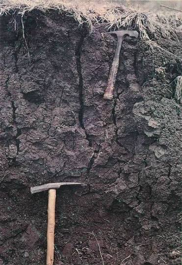{width="300px"}

:::

:::

:::

## Gênese da estrutura do solo
<hr>

[__Processos biológicos:__]{.fg style="--col: #e64173"}

::: {.incremental}

- Atividade dos microrganismos, da fauna e das plantas;
- Aproximação e união de partículas minerais por compostos orgânicos produzidos por microrganismos;

:::

## Gênese da estrutura do solo
<hr>

[__Processos biológicos:__]{.fg style="--col: #e64173"}

::: {.incremental}

- Bactérias: gomas, polissacarídeos;
  - Compostos "pegajosos" que unem os agregados;
- Fungos: hifas;
  - Estabilizam os agregados;
- Minhocas, formigas e cupins: criam galerias e deslocam partículas do solo;
  - Fragmentam agregados em unidades menores (poros).

:::

## Gênese da estrutura do solo
<hr>

[__Processos biológicos:__]{.fg style="--col: #e64173"}

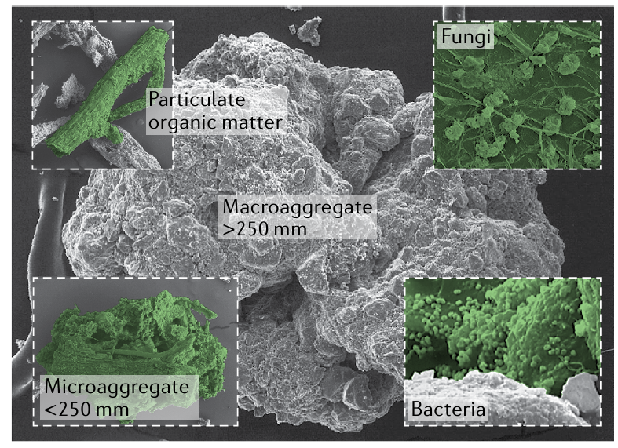{fig-align="center"}

# Organização hierárquica dos agregados

## Organização hierárquica dos agregados
<hr>

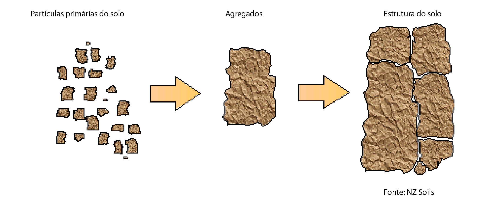{fig-align="center"}

## Organização hierárquica dos agregados
<hr>

[__Classificação:__]{.fg style="--col: #e64173"}

::: {.incremental}

- Microagregados: menores que 0,25 mm;
- Macroagregados: maiores que 0,25 mm.

:::


::: {.fragment}

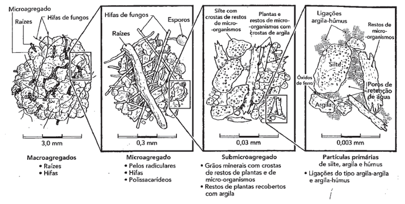{fig-align="center"}

:::

## Organização hierárquica dos agregados
<hr>

[__Classificação:__]{.fg style="--col: #e64173"}

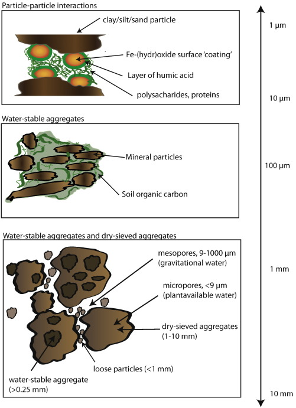{fig-align="center"}

## Organização hierárquica dos agregados
<hr>

[__Classificação:__]{.fg style="--col: #e64173"}

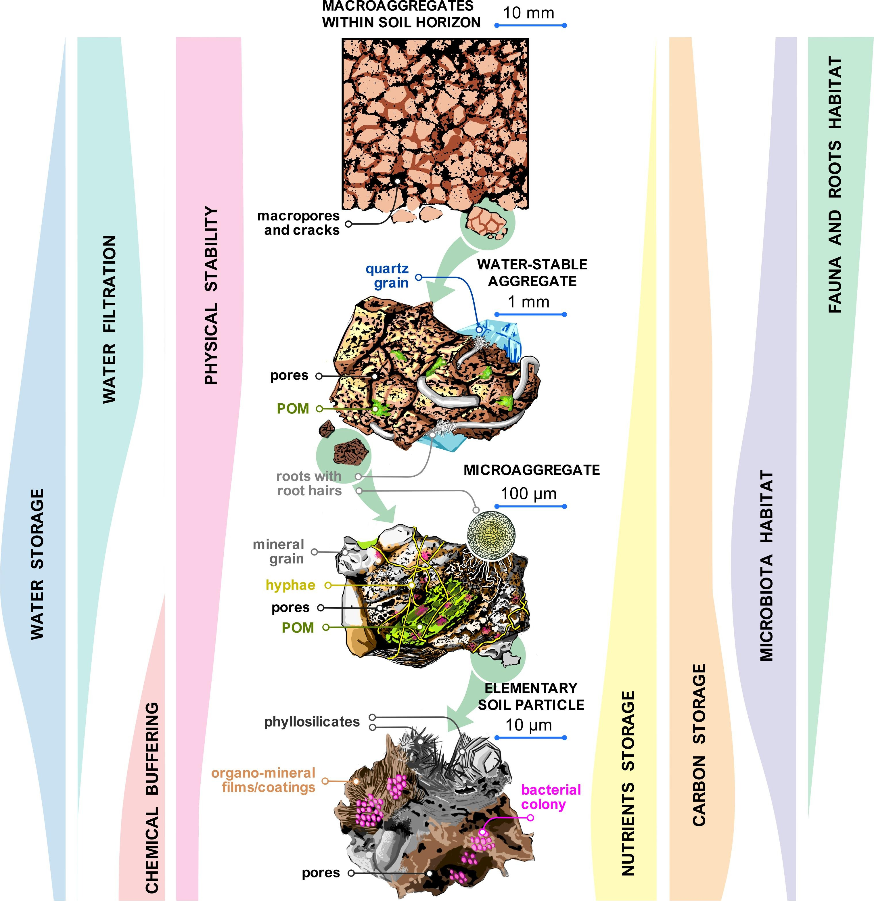{fig-align="center"}

## Abordagens para avaliar a estrutura
<hr>

Importante para avaliar o efeito da gênese e das práticas de uso e manejo do solo na agregação.

::: {.fragment}

Métodos qualitativos e quantitativos

:::

::: {.fragment}

Abordagem pedológica, mecânica e ecológica.

:::

## Abordagens para avaliar a estrutura
<hr>

[__Abordagem pedológica:__]{.fg style="--col: #e64173"}

A estrutura é avaliada qualitativamente pelo formato, tamanho e grau de desenvolvimento.

::: {.incremental}

- Os agregados são separados por planos de fraqueza;
- Retira-se um bloco e se separam as unidades por meio da aplicação de força de tração;

:::

## Abordagens para avaliar a estrutura
<hr>

[__Abordagem pedológica:__]{.fg style="--col: #e64173"}

Classificação dos formatos

::: {.incremental}

- Grãos (granular);
- Lâminas (laminar);
- Cubos (blocos);
- Colunas (colunar);
- Prismas (prismática);

:::


::: {.fragment}

Obs: Na maior parte dos solos temos um tipo granular e blocos subangulares.

:::

## Abordagens para avaliar a estrutura
<hr>

[__Abordagem pedológica:__]{.fg style="--col: #e64173"}

Classificação dos formatos

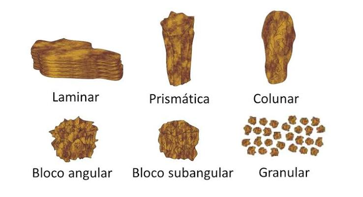{fig-align="center"}

## Abordagens para avaliar a estrutura
<hr>

[__Abordagem pedológica:__]{.fg style="--col: #e64173"}

Classificação dos tamanhos das unidades

| Classe de tamanho | Laminar (mm) | Prismática e colunar (mm) | Blocos angulares e subangulares (mm) | Granular (mm) |
|:---|---:|---:|---:|---:|
| **Muito pequena** | < 1 | < 10 | < 5 | < 1 |
| **Pequena** | 1 a 2 | 10 a 20 | 5 a 10 | 1 a 2 |
| **Média** | 2 a 5 | 20 a 50 | 10 a 20 | 2 a 5 |
| **Grande** | 5 a 10 | 50 a 100 | 20 a 50 | 5 a 10 |
| **Muito grande** | > 10 | > 100 | > 50 | > 10 |

## Abordagens para avaliar a estrutura
<hr>

[__Abordagem pedológica:__]{.fg style="--col: #e64173"}

Classificação do grau de desenvolvimento da estrutura


::: {.fragment}

Representa a coesão de dentro e de fora dos agregados (força de cimentação e de estabilização).

:::


::: {.fragment}

3 categorias: grãos simples, maciça e agregada

:::

## Abordagens para avaliar a estrutura
<hr>

[__Abordagem pedológica:__]{.fg style="--col: #e64173"}

Classificação do grau de desenvolvimento da estrutura

::: {.incremental}

- Grãos simples: Solos arenosos;
- Maciça: Solos hidromórficos ou solos com alta compactação;
- Agregada: Mais adequada para desenvolvimento de plantas;
  - Fraco: Unidades estruturais pouco frequentes em relação ao solo que não está agregado;
  - Moderada: Unidades estruturais em quantidade semelhante ao solo não agregado;
  - Forte: Unidades estruturais de fácil separação e maior quantidade em relação ao solo não agregado.

:::

## Abordagens para avaliar a estrutura
<hr>

[__Abordagem ecológica ou edafológica:__]{.fg style="--col: #e64173"}

Considera a estrutura quanto à forma, ao tamanho e à resistência de agregados do solo.

Também leva em conta a funcionalidade da estrutura

- Reter e transmitir fluidos e materiais;
- Suporte ao crescimento de raízes.


## Abordagens para avaliar a estrutura
<hr>

[__Abordagem ecológica ou edafológica:__]{.fg style="--col: #e64173"}


::: {.fragment}

Baseada em 3 aspectos

::: {.incremental}

- Graus de agregação: distribuição por tamanho e estabilidade;
- Porosidade: tamanho, forma, tortuosidade, continuidade e estabilidade de poros;
- Alteração espacial e temporal em agregados e poros em relação a fatores naturais e antropogênicos.

:::

:::


# Avaliação da estrutura métodos

## Avaliação da estrutura
<hr>

[__Métodos:__]{.fg style="--col: #e64173"}


```{dot}
//| fig-width: 10
//| fig-height: 5
//| fig-align: center

digraph {

    graph [
        rankdir=TB
        bgcolor="transparent"
        nodesep=0.35
        ranksep=0.55
        pad=0.15
        margin=0
        splines=ortho
    ]

    node [
        shape=box
        style="filled"
        fontname="Arial"
        fontsize=22
        fontcolor="#1F2933"
        color="#4A4A4A"
        penwidth=1.5
        margin="0.20,0.12"
    ]

    edge [
        color="#4A4A4A"
        penwidth=1.5
        arrowhead=none
    ]


    # Título principal
    A [
        label="Avaliação da agregação do\nsolo"
        fillcolor="#F2F2F2"
    ]


    # Métodos principais
    CAMPO [
        label="Métodos de\ncampo"
        fillcolor="#CFE5C5"
        color="#6E9B67"
    ]

    LAB [
        label="Métodos de\nlaboratório"
        fillcolor="#3E78AE"
        fontcolor="white"
        color="#24547D"
    ]


    # Métodos de campo
    PERFIL [
        label="Perfil cultural"
        fillcolor="#D9EBD2"
        color="#7BA572"
    ]

    VESS [
        label="VESS"
        fillcolor="#D9EBD2"
        color="#7BA572"
    ]

    DRES [
        label="DRES"
        fillcolor="#D9EBD2"
        color="#7BA572"
    ]


    # Métodos de laboratório
    RES [
        label="Resistência dos\nagregados"
        fillcolor="#3E78AE"
        fontcolor="white"
        color="#24547D"
    ]

    SECO [
        label="Peneiramento\nseco"
        fillcolor="#3E78AE"
        fontcolor="white"
        color="#24547D"
    ]

    UMIDO [
        label="Peneiramento\númido"
        fillcolor="#3E78AE"
        fontcolor="white"
        color="#24547D"
    ]


    # Hierarquia principal
    A -> CAMPO
    A -> LAB


    # Hierarquia secundária
    CAMPO -> PERFIL
    CAMPO -> VESS
    CAMPO -> DRES

    LAB -> RES
    LAB -> SECO
    LAB -> UMIDO


    # Mantém os nós da mesma hierarquia alinhados
    { rank=same; CAMPO; LAB }

    { rank=same;
        PERFIL
        VESS
        DRES
        RES
        SECO
        UMIDO
    }

    # Espaçamento e ordem visual
    PERFIL -> VESS [style=invis, weight=10]
    VESS -> DRES [style=invis, weight=10]
    DRES -> RES [style=invis, weight=20]
    RES -> SECO [style=invis, weight=10]
    SECO -> UMIDO [style=invis, weight=10]
}
```

## Avaliação da estrutura
<hr>

[__Campo:__]{.fg style="--col: #e64173"}

Qualitativos (perfil cultural)


::: {.fragment}

Observação da organização e da morfologia das estruturas no perfil. Delimitação de porções em profundidade e lateralmente com base em critérios de forma, tamanho, dureza e distribuição dos agregados. Presença ou ausência de poros visíveis a olho nu e continuidade.

[Artigo](https://doi.org/10.1590/S0100-06831999000200022)

:::

## Avaliação da estrutura
<hr>

[__Campo:__]{.fg style="--col: #e64173"}

VESS - Visual Evaluation of Soil Structure

Rápido e de baixo custo para qualificar a camada superficial em condições de campo.

::: {.incremental}

- Extração de uma fatia de solo com 25 cm de profundidade, 10 cm de espessura e 20 cm de largura;
- Fragmentação manual dos agregados em seus limites naturais ou pontos de fraqueza;


:::

## Avaliação da estrutura
<hr>

[__Campo:__]{.fg style="--col: #e64173"}

VESS - Visual Evaluation of Soil Structure

::: {.incremental}

- Tamanho, estabilidade e a porosidade dos agregados e raízes;
- Comparação com uma chave visual (5 níveis de qualidade);
  - 1 estrutura boa e 5 estrutura pobre.
- Calculada uma nota ou índice de qualidade para a estrutura do solo.

:::


::: {.fragment}

Adequado para monitorar e prever futuras melhorias ou ações de readequação de manejos adotados na área agrícola.

:::


::: {.fragment}

[Chave de avaliação](http://paginapessoal.utfpr.edu.br/rachelguimaraes/vess/avaliacao-visual-da-estrutura-do-solo-2/avaliacao-visual-da-estrutura-do-solo-1/avaliacao-visual-da-estrutura-do-solo/Avaliacao%20visual%20da%20estrutura%20do%20solo.pdf)

:::

## Avaliação da estrutura
<hr>

[__Campo:__]{.fg style="--col: #e64173"}

DRES - Diagnóstico Rápido da Estrutura do Solo (Feito no Brasil!)

::: {.incremental}

- Coleta de fatia de solo: 10 cm de espessura, 20 cm de largura e até 25 cm de profundidade;
- Alocação em bandeja.
- Manipulação do solo para se observar a forma e o tamanho dos agregados;
  - Presença ou não de feições de compactação;
  - Forma e orientação das fissuras;
  - Rugosidade das faces de ruptura;
  - Resistência à ruptura;
  - Distribuição e o aspecto do sistema radicular;
  - Atividade biológica.

:::

## Avaliação da estrutura
<hr>

[__Campo:__]{.fg style="--col: #e64173"}

DRES - Diagnóstico Rápido da Estrutura do Solo (Feito no Brasil!)

Pontos de 1 até 6

- 1 é indicativo de solo degradado;
- 6 indicativo de melhor condição estrutural;

[Avaliação](https://www.embrapa.br/busca-de-publicacoes/-/publicacao/1071136/dres-diagnostico-rapido-da-estrutura-do-solo)

## Avaliação da estrutura métodos
<hr>

[__Laboratório:__]{.fg style="--col: #e64173"}

::: {.incremental}

- Peneiramento seco: determina a quantidade de agregados estáveis;
- Peneiramento úmido: simula a quantidade de agregados estáveis após serem submetidos à energia disruptiva (água);

:::

## Avaliação da estrutura métodos
<hr>

[__Laboratório:__]{.fg style="--col: #e64173"}

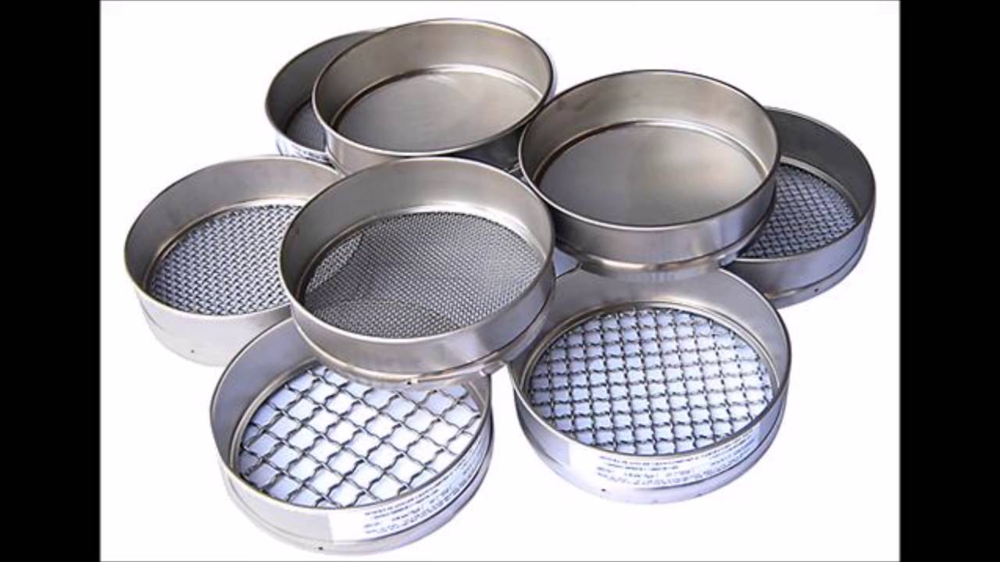{fig-align="center"}

## Avaliação da estrutura métodos
<hr>

[__Laboratório:__]{.fg style="--col: #e64173"}

$$AGR_{c1} = \frac{mag_1}{mag_t}*100$$

$AGR_{c1}=percentual~de~agregados~estáveis~na~classe~1$

$mag_1= massa~de~agregados~retido~na~c1$

$mag_t=massa~de~agregados~em~todas~as~classes$

## Avaliação da estrutura métodos
<hr>

[__Laboratório:__]{.fg style="--col: #e64173"}

$$DMP = \sum^n_{i=1} \frac{Dm_i*mag_i}{mag_t}$$
$DMP=Diâmetro~médio~ponderado$

$Dm_i=diâmetro~médio~da~classe_i$


# Melhoria da estrutura

## Melhoria da estrutura
<hr>

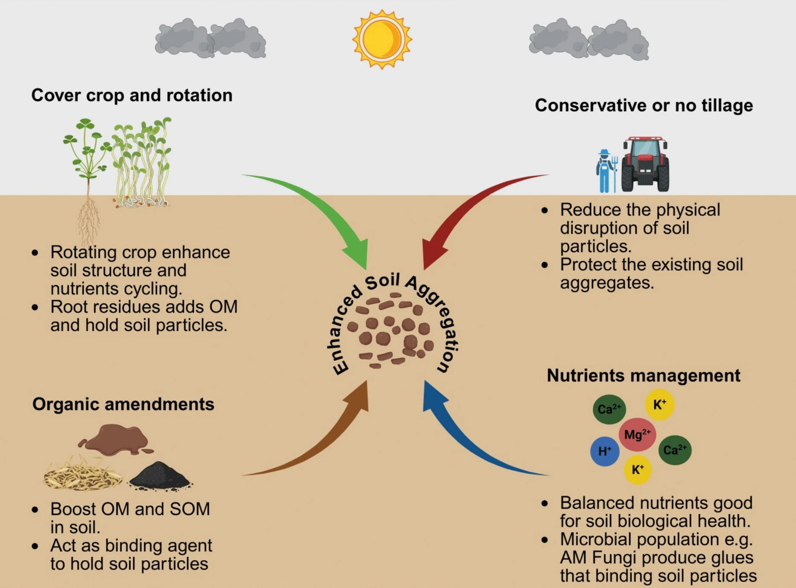{fig-align="center"}

## Melhoria da estrutura
<hr>

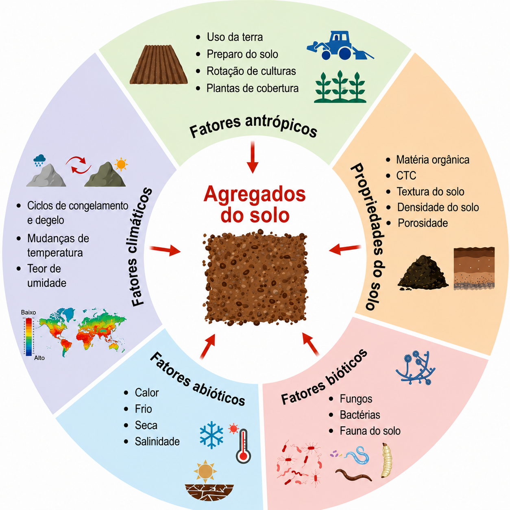{fig-align="center"}

# Fim!