# O que é densidade?
<hr>

## O que é densidade?
<hr>

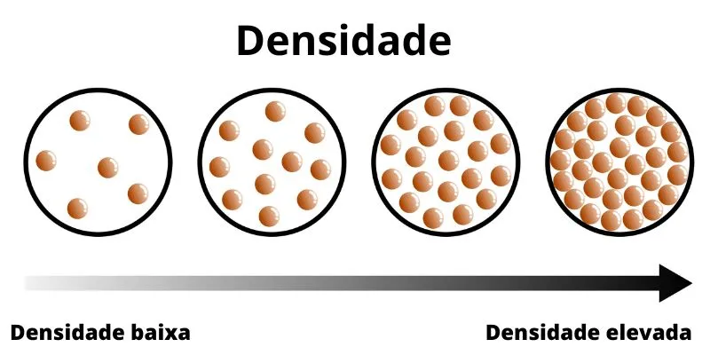{fig-align="center"}

::: {.fragment}

Densidade é a relação da massa de um corpo com o volume que ele ocupa no espaço.

:::

::: {.incremental}

- Todos os corpos apresentam uma densidade;
- A densidade absoluta é uma característica própria de cada material (ex);
- Densidade de sólidos > líquidos > gases;

:::

## O que é densidade?
<hr>

A densidade do solo é a relação entre a **massa de solo seco** (M~s~, g) com o seu **volume total** (V~t~, cm^3^).


::: {.incremental}

- O volume, no caso do solo, leva em conta o espaço poroso e os sólidos.
- A densidade é variável no espaço, no tempo e na profundidade do solo;
- Varia em relação ao tipo de solo e à sua composição.

:::


## Densidade do solo
<hr>

A densidade é fixa?

::: {.fragment}

Como modificar?

:::


{fig-align="center"}


::: {.fragment}

O solo é um sistema trifásico e o volume ocupado pela fração sólida pode mudar!

:::

## Densidade do solo
<hr>

Onde a densidade é maior?

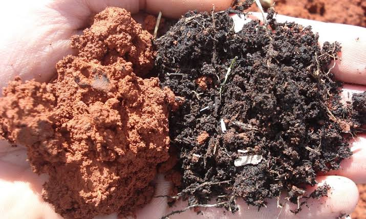{fig-align="center"}


# Determinação da densidade do solo
<hr>

## Determinação da densidade do solo
<hr>

Os métodos devem ser capazes de determinar a massa de solo seco, bem como o volume total em que ele se encontra na natureza.

::: {.fragment}

**Amostras com estrutura preservada!**

:::


::: {.fragment}

Dois métodos principais:

::: {.incremental}

- Método do cilindro volumétrico;
- Método do torrão parafinado.

:::

:::

## Determinação da densidade do solo
<hr>

[__Método do cilindro volumétrico:__]{.fg style="--col: #e64173"}


::: {.fragment}

Utiliza-se um cilindro metálico de volume conhecido, o qual é inserido no solo para a coleta das amostras com estrutura preservada.

:::

::: {.fragment}

Etapas:

::: {.incremental}

- Inserção de cilindro com volume conhecido no solo (V~t~);
- Limpeza de bordas;
- Amostra de solo contida no cilindro é levada ao laboratório;
- A amostra é seca em estufa para obter a M~s~

:::

:::

## Determinação da densidade do solo
<hr>

[__Método do cilindro volumétrico:__]{.fg style="--col: #e64173"}

::: {layout-ncol="2"}

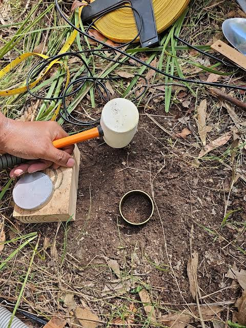{fig-align="center" width="350px"}

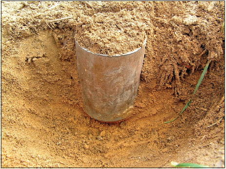{fig-align="center"}


:::

## Determinação da densidade do solo
<hr>

[__Método do cilindro volumétrico:__]{.fg style="--col: #e64173"}

::: {layout-ncol="2"}

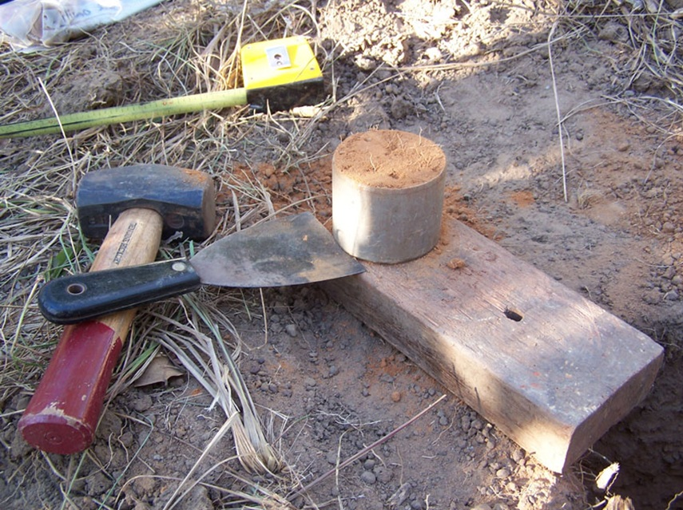{fig-align="center"}

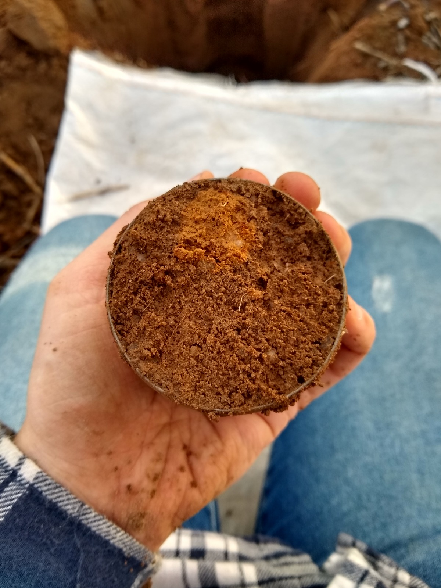{fig-align="center" width="380px"}


:::

## Determinação da densidade do solo
<hr>

[__Método do cilindro volumétrico:__]{.fg style="--col: #e64173"}

Exemplos:

::: {.fragment}

Em uma área de vegetação nativa foi realizada a coleta para densidade do solo. O cilindro utilizado possui 8 cm de diâmetro interno e 12 cm de altura. Após a secagem, a amostra continha 881 g. Qual a densidade desse solo?

:::


::: {.fragment}

Volume:

$$V (cm^3) = \pi*\frac{D^2}{4}*h$$

$D = Diâmetro~interno~(cm)$ e $h = Altura~do~cilindro~(cm)$


:::

## Determinação da densidade do solo
<hr>

[__Método do cilindro volumétrico:__]{.fg style="--col: #e64173"}

Exemplos:

Em uma área de vegetação nativa foi realizada a coleta para densidade do solo. O cilindro utilizado possui 8 cm de diâmetro interno e 12 cm de altura. Após a secagem, a amostra continha 881 g. Qual a densidade desse solo?

::: {.fragment}

Volume:

$$V (cm^3) = \pi*\frac{8^2}{4}*12$$

$$V = 603,1858~cm^3$$

:::

## Determinação da densidade do solo
<hr>

[__Método do cilindro volumétrico:__]{.fg style="--col: #e64173"}

Exemplos:

Em uma área de vegetação nativa foi realizada a coleta para densidade do solo. O cilindro utilizado possui 8 cm de diâmetro interno e 12 cm de altura. Após a secagem, a amostra continha 881 g. Qual a densidade desse solo?


::: {.fragment}

$$D_s=\frac{M_s}{V_t}$$


:::


## Determinação da densidade do solo
<hr>

[__Método do cilindro volumétrico:__]{.fg style="--col: #e64173"}

Exemplos:

Em uma área de vegetação nativa foi realizada a coleta para densidade do solo. O cilindro utilizado possui 8 cm de diâmetro interno e 12 cm de altura. Após a secagem, a amostra continha 881 g. Qual a densidade desse solo?


::: {.fragment}

$$D_s=\frac{881~g}{603,1858~cm^3}$$


:::


::: {.fragment}

$$D_s=1,46~g~cm^3$$

:::

## Determinação da densidade do solo
<hr>

[__Método do torrão parafinado:__]{.fg style="--col: #e64173"}


::: {.fragment}

Utilizado para determinar a densidade em solos com presença de fragmentos de rochas e concreções, os quais impossibilitam a utilização do método do cilindro metálico.

:::

## Determinação da densidade do solo
<hr>

[__Método do torrão parafinado:__]{.fg style="--col: #e64173"}

::: {.fragment}

Etapas:

::: {.incremental}

- Utiliza-se um torrão de solo como amostra;
  - Com volume aproximado de 100 cm^3^ (3 a 5 cm de diâmetro);
  - Coleta em campo e com proteção;
- Pesagem da amostra em laboratório;
- Amostra é imersa em parafina líquida (aquecida);
  - Impermeabilização;
- Segunda pesagem (amostra + parafina);
- Adicionar um béquer com água em seu limite máximo sobre uma balança;

:::

:::

## Determinação da densidade do solo
<hr>

[__Método do torrão parafinado:__]{.fg style="--col: #e64173"}


Etapas:

::: {.incremental}

- Medir a massa da água;
- Remover parte da água e adicionar o torrão;
- O torrão é então suspenso ao ar;
- Completar o béquer para o volume máximo novamente;
- Medir a massa da água mais o torrão;
  - O espaço ocupado pelo torrão é determinado pela diferença entre o volume total e o volume até completar após a adição do torrão;

:::

## Determinação da densidade do solo
<hr>

[__Método do torrão parafinado:__]{.fg style="--col: #e64173"}

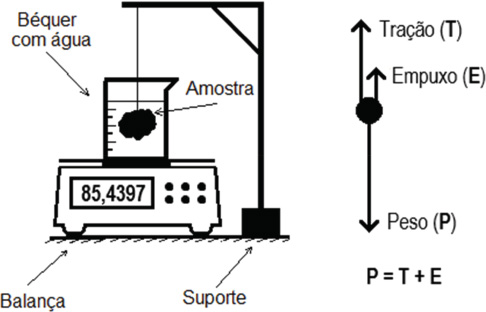{fig-align="center"}

# Fatores que afetam a densidade do solo
<hr>

## Fatores que afetam a densidade do solo
<hr>

::: {.columns}

::: {.column}

::: {.fragment}

**Intrínsecos**

::: {.incremental}

- Textura;
- Potencial de água;
- Estrutura;
- Densidade inicial;
- Mineralogia.

:::

:::


:::

::: {.column}

::: {.fragment}

**Extrínsecos**

::: {.incremental}

- Máquinas e implementos agrícolas;
- Tráfego de máquinas e animais;
- Manejo do solo.

:::

:::

:::

:::

## Fatores que afetam a densidade do solo
<hr>

[__Granulometria:__]{.fg style="--col: #e64173"}

Relação entre o peso da amostra (TFSA) e seu teor de areia considerando um volume fixo (2,5 ml)

{fig-align="center"}

## Fatores que afetam a densidade do solo
<hr>

[__Granulometria:__]{.fg style="--col: #e64173"}

Relação entre o peso da amostra (TFSA) e seu teor de argila considerando um volume fixo (2,5 ml)

{fig-align="center"}

## Fatores que afetam a densidade do solo
<hr>

[__Granulometria:__]{.fg style="--col: #e64173"}

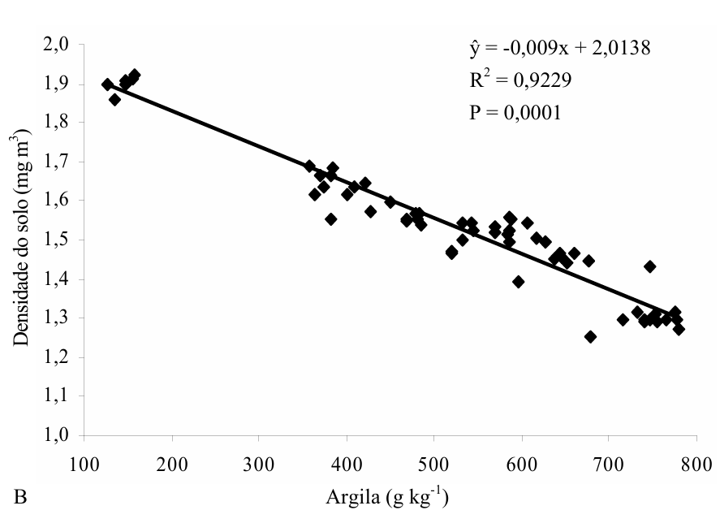{fig-align="center"}

## Fatores que afetam a densidade do solo
<hr>

[__Granulometria:__]{.fg style="--col: #e64173"}

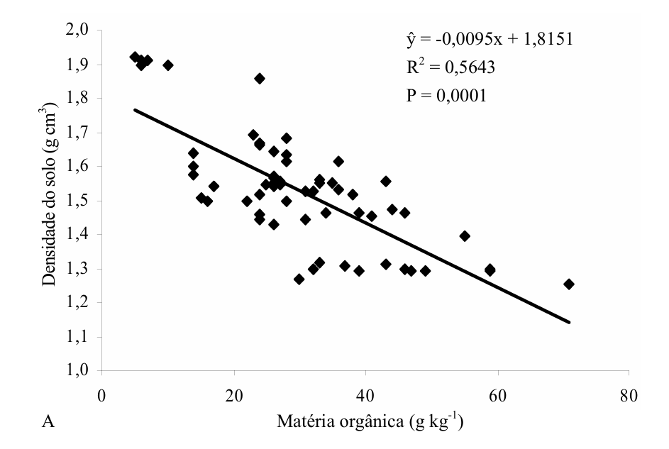{fig-align="center"}

# Relação entre a densidade e aspectos agronômicos
<hr>

## Relação entre a densidade e aspectos agronômicos
<hr>


::: {.columns}

::: {.column}

[__Plantio direto:__]{.fg style="--col: #e64173"}

Plantio direto modifica a densidade? De que forma?


::: {.fragment}

- Noroeste do Estado do Paraná;
- Ano agrícola 1999/2000; 
- Latossolo Vermelho distrófico.

:::


:::

::: {.column}

::: {.fragment}

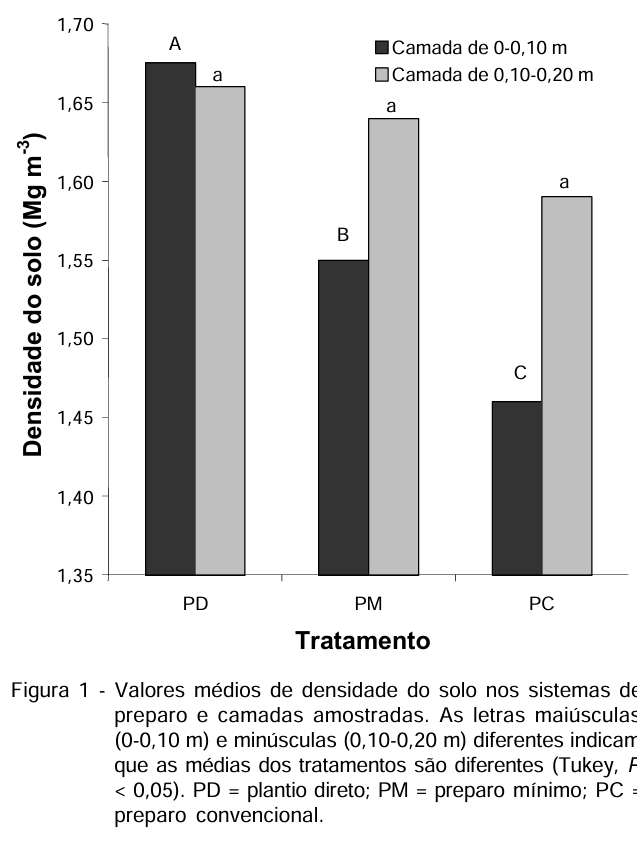{width="350px"}

:::

:::

:::

## Relação entre a densidade e aspectos agronômicos
<hr>

[__Plantio direto:__]{.fg style="--col: #e64173"}

- Santo Antônio de Goiás, GO;
- Latossolo Vermelho distrófico;
- O trabalho foi conduzido sob irrigação por aspersão, sistema pivô central, por seis anos consecutivos, 1999 a 2004, durante os quais foram realizados doze cultivos. 

::: {.fragment}

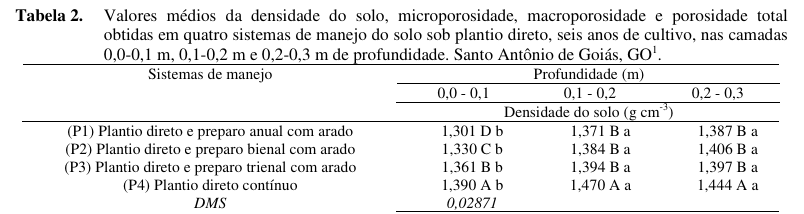{fig-align="center"}

:::

## Relação entre a densidade e aspectos agronômicos
<hr>

[__Plantio direto:__]{.fg style="--col: #e64173"}

- Uberaba, Minas Gerais;
- Latossolo Vermelho distrófico;

::: {.fragment}

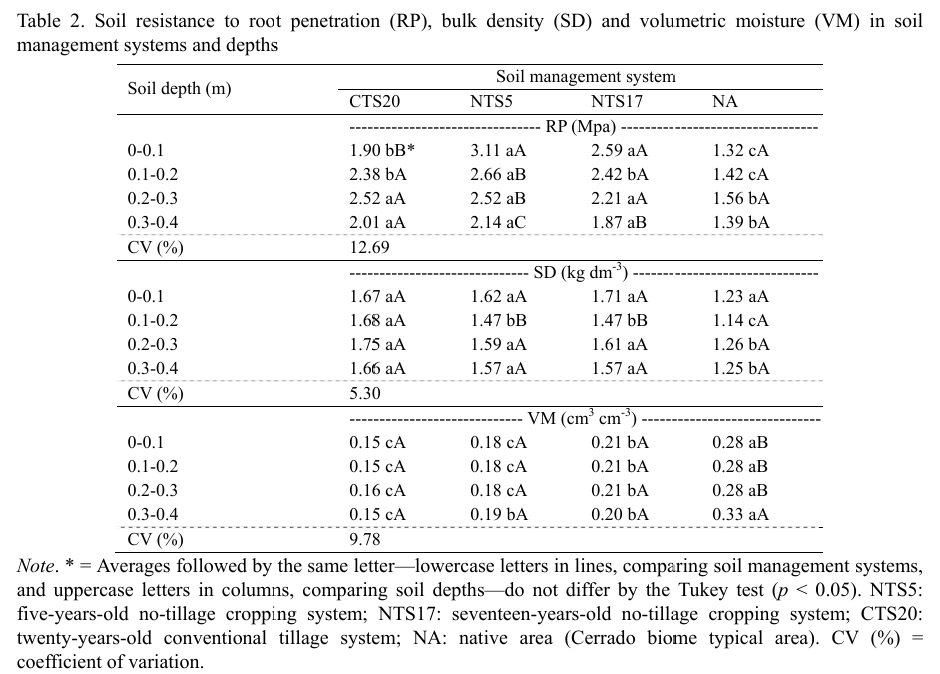{fig-align="center" width="500px"}

:::

## Relação entre a densidade e aspectos agronômicos
<hr>

[__Rotação de culturas:__]{.fg style="--col: #e64173"}

- Montividiu, Goiás;
- Latossolo Vermelho distrófico;

::: {.fragment}

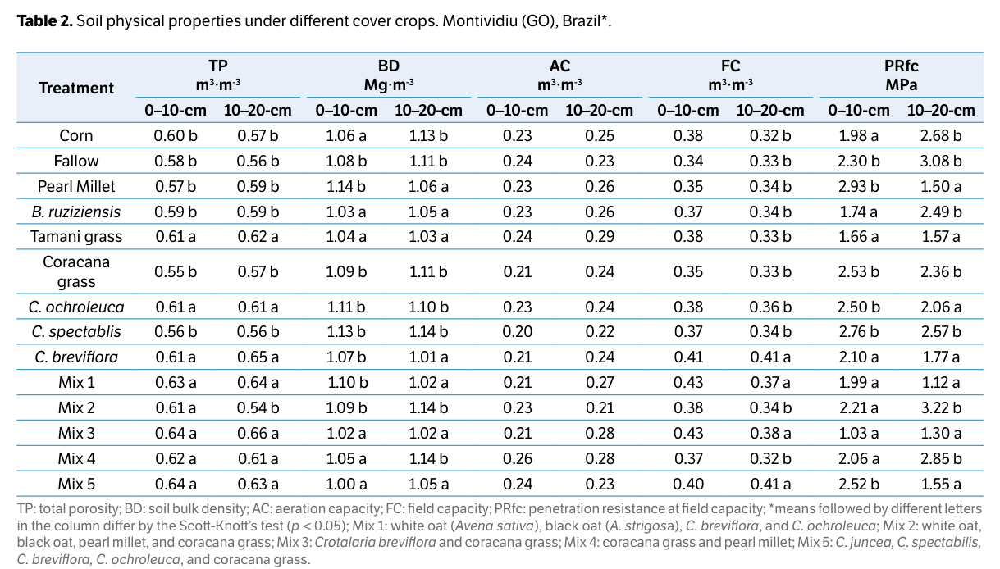{fig-align="center" width="620px"}

:::

## Relação entre a densidade e aspectos agronômicos
<hr>

[__Rotação de culturas:__]{.fg style="--col: #e64173"}

- Montividiu, Goiás;
- Latossolo Vermelho distrófico;

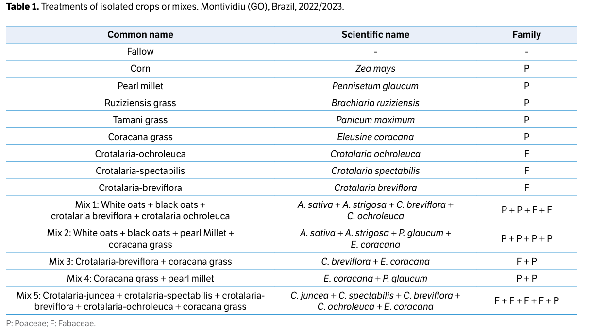{fig-align="center" width="620px"}

## Relação entre a densidade e aspectos agronômicos
<hr>

[__Produção das culturas:__]{.fg style="--col: #e64173"}

::: {style="font-size:20px"}

Tuzzin, M. et al. 2020

- Produtividade de soja;
- a = densidade, b = comprimento de raízes (RLD);
- 0 a 20 cm, em um Latossolo Vermelho.
- MTC: sistema de cultivo mínimo com escarificação do solo; NT: sistema de plantio direto; e plantio direto com compactação adicional por quatro passadas do trator (NTC4) ou oito passadas da colhedora (NTC8).

:::

::: {layout-ncol="2"}

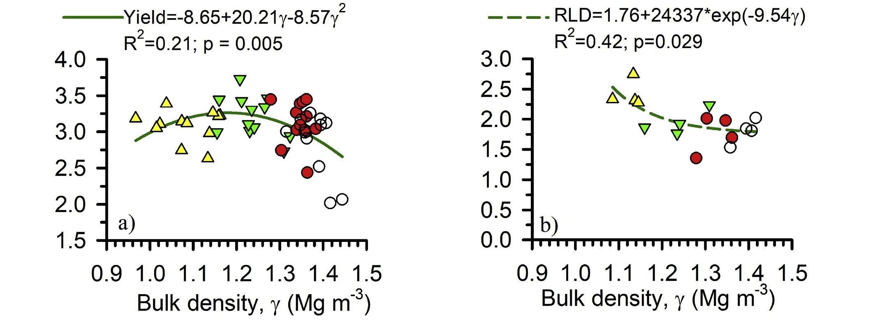{width="850px" fig-align="center"}

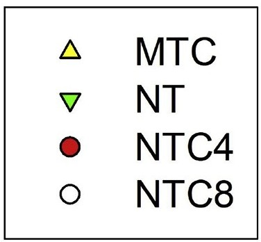{width="100px" fig-align="left"}

:::

# Densidade de partícula
<hr>

## Densidade de partícula (Dp)
<hr>

É a relação entre a massa (M~s~) e o volume das partículas do solo (V~s~)...

::: {.fragment}

...partículas sólidas.

:::

::: {.fragment}

A Dp é importante para o tempo de sedimentação das partículas do solo em água, em estudos sobre erosão e granulometria.


::: {.fragment}

Utilizada para calcular a porosidade total do solo.

:::

:::

## Densidade de partícula (Dp)
<hr>

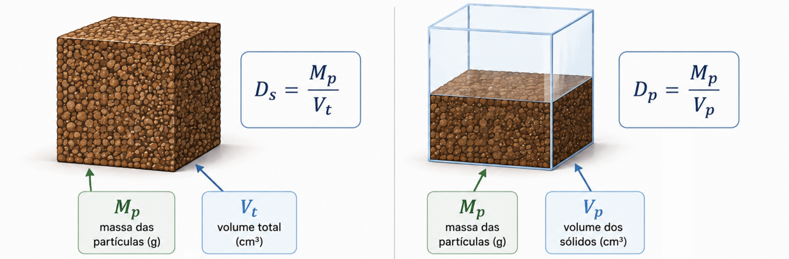{fig-align="center"}

## Densidade de partícula (Dp)
<hr>

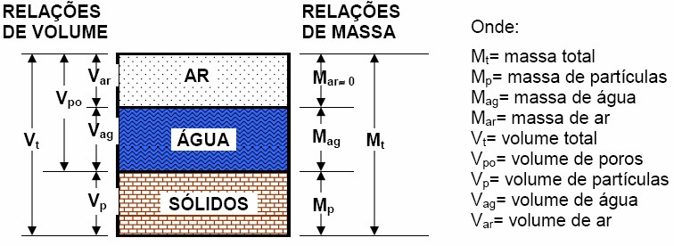{fig-align="center"}


::: {.fragment}

Densidade do solo vs densidade de partícula

:::

## Densidade de partícula (Dp)
<hr>

$$Dp = \frac{Mp}{Vp}$$

$Dp = Densidade~de~partículas$

$Mp = Massa~de~partículas$

$Vp = Volume~de~partículas$


## Densidade de partícula (Dp)
<hr>

[__Densidade do solo e das partículas:__]{.fg style="--col: #e64173"}


::: {.columns}

::: {.column}

**Densidade do solo**

$D_s = \frac{M_s}{V_t}$


:::

::: {.column}

**Densidade de partícula**

$D_p = \frac{M_s}{V_p}$


:::

:::

## Densidade de partícula (Dp)
<hr>

[__Densidade do solo e das partículas:__]{.fg style="--col: #e64173"}

Considere: Massa de solo: 1,8 g; Volume total: 1 cm^3^; Volume de partícula: 0,5 cm^3^.

::: {.columns}

::: {.column}


::: {.fragment}

**Densidade do solo**

$D_s = \frac{M_s}{V_t}$

$D_s = \frac{1,8}{1} = 1,8~g~cm^3$

:::

:::

::: {.column}


::: {.fragment}

**Densidade de partícula**

$D_p = \frac{M_s}{V_p}$

$D_p = \frac{1,8}{0,5}=3,6~g~cm^3$

:::

:::

:::

# Determinação da densidade de partículas
<hr>

## Determinação da densidade de partículas
<hr>

[__Método do balão volumétrico:__]{.fg style="--col: #e64173"}

::: {.incremental}

- Determinação da massa do solo em balança;
  - Amostra seca em estufa a 105ºC;
- Determinação do volume por deslocamento de líquidos.

:::

## Determinação da densidade de partículas
<hr>

[__Método do balão volumétrico:__]{.fg style="--col: #e64173"}

::: {.incremental}

- Quantidade de líquido (álcool) para preencher um balão volumétrico vazio;
- Quantidade de líquido para preencher um balão contendo partículas de solo.
  - Medida via bureta.

:::


::: {.fragment}

$$D_p = \frac{M_s}{(V_b-V_u)}$$

::: {style="font-size:22px"}

V~b~ é o volume do balão volumétrico (cm^3^), V~u~ é o volume de álcool utilizado para completar o balão com a amostra (cm^3^).

:::

:::

## Densidade de partículas
<hr>

::: {.tbl}

| Mineral | Densidade ($g\,cm^{-3}$) |
|:---|---:|
| Caulinita | 2,65 |
| Quartzo | 2,65 |
| Hematita | 5,26 |
| Magnetita | 5,18 |
| Anatásio | 3,90 |
| Gibbsita | 2,35 |

Fonte: Azevedo e Dalmolin (2006).

:::

# Densidade de partículas e propriedades do solo
<hr>

## Densidade de partículas e propriedades do solo
<hr>

O manejo e uso do solo podem alterar a densidade de partículas?


::: {.fragment}

O que podemos alterar do solo?

:::

::: {.fragment}

Mineralogia ou matéria orgânica?

:::

## Densidade de partículas e propriedades do solo
<hr>

Podemos alterar a distribuição mineral do solo?

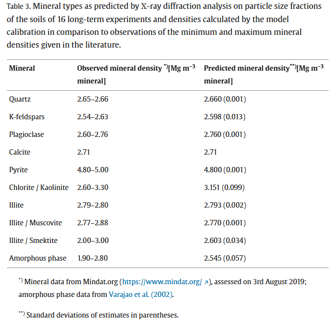{fig-align="center"}


## Densidade de partículas e propriedades do solo
<hr>

::: {.fragment}

Podemos incrementar matéria orgânica!

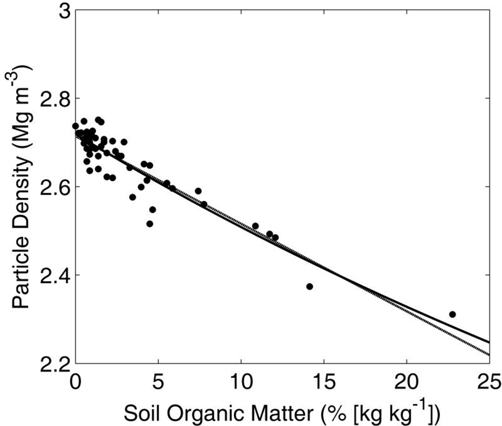{fig-align="center" width="550px"}

:::


# Exercícios
<hr>

## Exercícios
<hr>

```{r}

library(countdown)

countdown(
  minutes = 0,
  seconds = 40,
  # left = ,
  # bottom = 0,
  right = 0,
  top = 0,
  padding = "5px",
  margin = "0%",
  # font_size = "6em"
)
```

1 - Uma amostra de solo foi coletada para determinação da densidade pelo método do cilindro. A massa de solo seca foi de 600 g e o volume do cilindro é de 350 cm^3^. Qual a densidade desse solo?

::: {.fragment}

Resposta:

$$D_s= \frac{600g}{350cm^3}$$

:::


::: {.fragment}

$$D_s= 1,714~g~cm^3$$

:::

## Exercícios
<hr>

```{r}

library(countdown)

countdown(
  minutes = 0,
  seconds = 50,
  # left = ,
  # bottom = 0,
  right = 0,
  top = 0,
  padding = "5px",
  margin = "0%",
  # font_size = "6em"
)
```

2 - Uma amostra de solo apresentou uma densidade de 1,08 g cm^3^ quando medida utilizando um cilindro de 125 cm^3^ de volume. Qual a massa de solo seco dessa amostra?

::: {.fragment}

Resposta:

$$1,08~g~cm^3= \frac{x~g}{125~cm^3}$$

:::


::: {.fragment}

$$x= 1,08*125= 135~g$$

:::

## Exercícios
<hr>

```{r}

library(countdown)

countdown(
  minutes = 5,
  seconds = 0,
  # left = ,
  # bottom = 0,
  right = 0,
  top = 0,
  padding = "5px",
  margin = "0%",
  # font_size = "6em"
)
```

3 - Para a determinação da densidade, um pesquisador utilizou um cilindro com 84 mm de diâmetro e 112 mm de altura. Depois de seco, o solo tinha uma massa de 680 g. Qual a densidade desse solo?

::: {.fragment}

Resposta:

$$V_c= \pi*r^2*h$$

:::


::: {.fragment}

$$V_c= \pi*(\frac{(84/10)}{2})^2*(112/10) = 620,678~cm^3$$

:::


::: {.fragment}

$$D_s= \frac{680~g}{620,68~cm^3}=1,10~g~cm^3$$

:::

## Exercícios
<hr>

```{r}

library(countdown)

countdown(
  minutes = 5,
  seconds = 0,
  # left = ,
  # bottom = 0,
  right = 0,
  top = 0,
  padding = "5px",
  margin = "0%",
  # font_size = "6em"
)
```

4 - Dois solos agricultáveis possuem densidade de 1,3 g cm^3^ para o solo "A" e de 1,7 g cm^3^ para o solo "B". Quais os fatores que podem estar associados a essa diferença de densidade? 

::: {.fragment}

Resposta:

::: {.incremental}

- Solo B pode estar sob sistema de plantio direto em relação ao solo A;
- O teor de argila do solo A pode ser maior do que o do solo B;
- O manejo de solo em A é melhor e pode ter propiciado acúmulo de matéria orgânica;
- Há um tráfego de máquinas menor no solo A (menos compactação);

:::

:::

## Exercícios
<hr>

```{r}

library(countdown)

countdown(
  minutes = 3,
  seconds = 0,
  # left = ,
  # bottom = 0,
  right = 0,
  top = 0,
  padding = "5px",
  margin = "0%",
  # font_size = "6em"
)
```

5 - Qual a diferença entre a densidade de partículas e do solo? Qual é maior?

::: {.fragment}

Resposta:

::: {.incremental}

- Densidade do solo leva em conta volume total (cilindro);
- Densidade de partícula leva em conta apenas o volume das partículas (sem poros);
- Densidade de partículas tende a ser maior que a densidade do solo (menor volume).

:::

:::

## Exercícios
<hr>

```{r}

library(countdown)

countdown(
  minutes = 3,
  seconds = 0,
  # left = ,
  # bottom = 0,
  right = 0,
  top = 0,
  padding = "5px",
  margin = "0%",
  # font_size = "6em"
)
```

6 - É possível um solo apresentar densidade do solo igual a de partículas? O que isso indica (em teoria)?

::: {.fragment}

Resposta:

::: {.incremental}

- Se as densidades tenderem a uma igualdade, isso significaria que o volume de poros tende a zero ($\lim_{V_p \rightarrow 0} D_s=D_p$)


:::

:::


## Exercícios
<hr>

**Atividade para o lar:**

::: {.fragment}

- Buscar na literatura qual a densidade média dos principais solos do Brasil.

:::

## Fim!
<hr>
