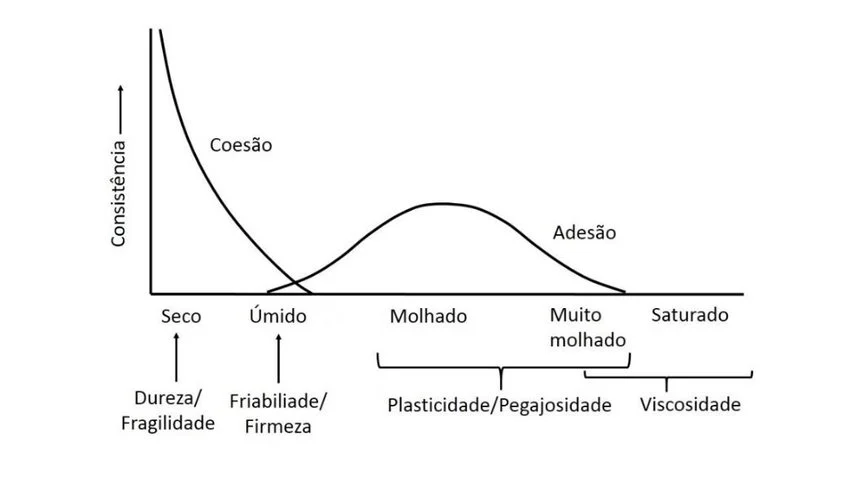
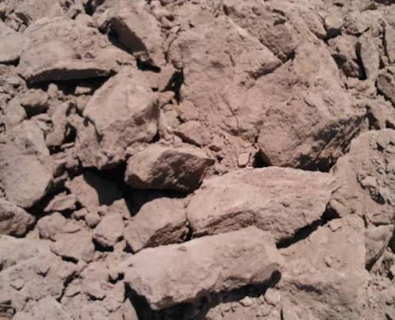
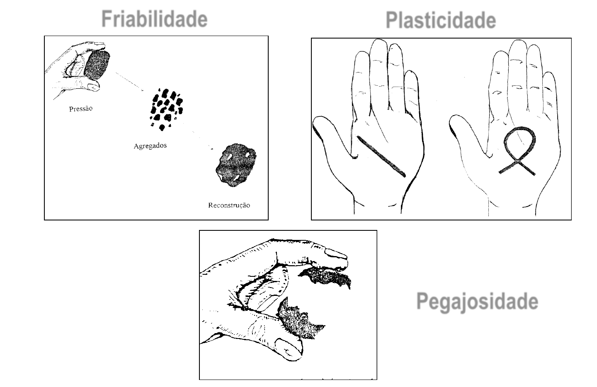
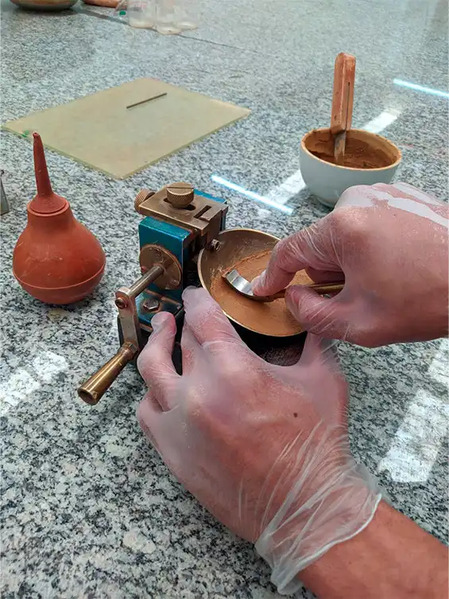
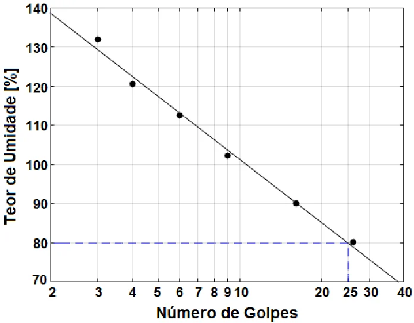
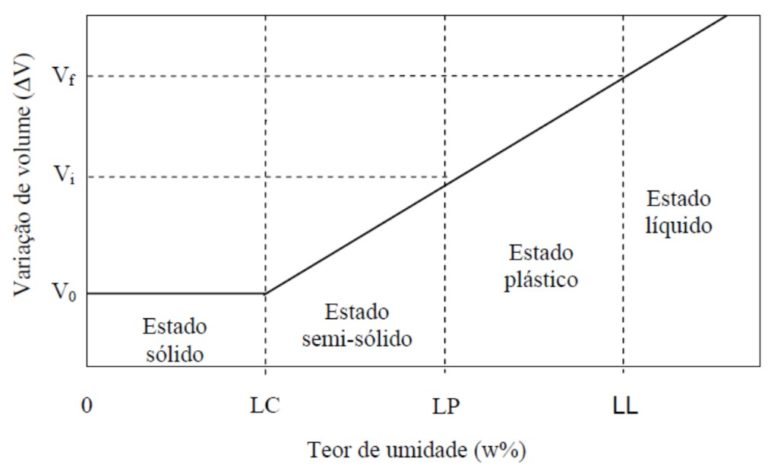
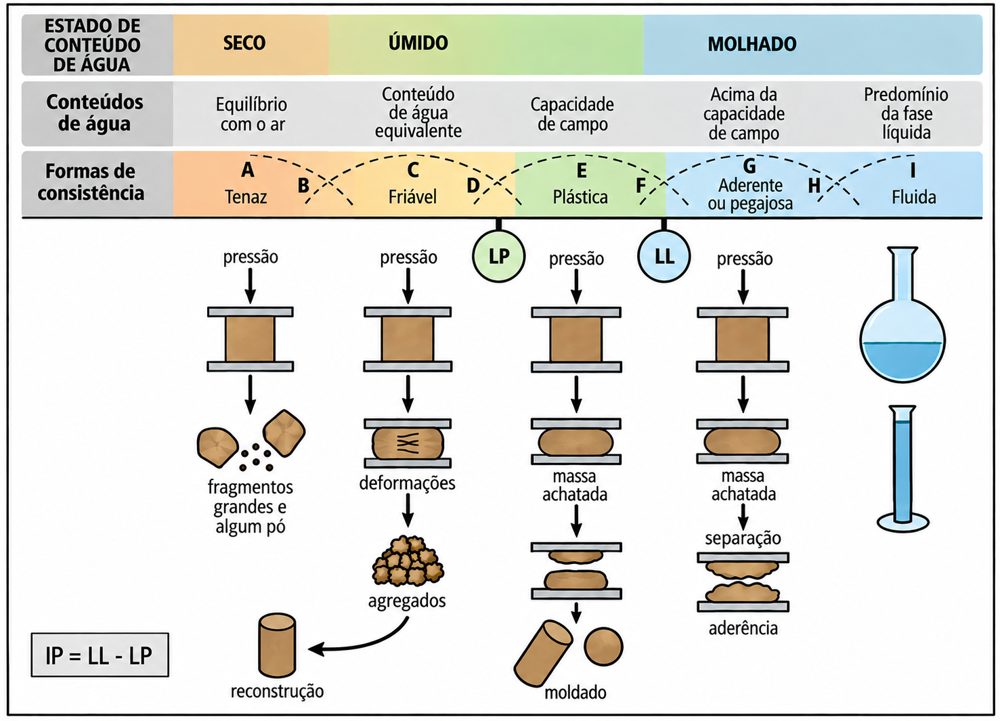

# O que é consistência do solo?
<hr>

::: {.notes}

Perguntar: por que o mesmo solo gruda na bota em um dia e vira pó no outro? O que mudou?

:::

## Consistência do solo
<hr>

::: {.fragment}

O mesmo solo pode se apresentar duro, friável ou pegajoso em diferentes momentos do ano.

:::

::: {.fragment}

O que muda não é o solo, mas o seu [__teor de água__]{.fg style="--col: #e64173"}.

:::

::: {.fragment}

A consistência descreve justamente esse comportamento.

:::

## Consistência do solo
<hr>

[__Definição:__]{.fg style="--col: #e64173"}

::: {.fragment}

> Consistência é a manifestação das forças físicas de coesão e adesão que atuam no solo, sob diferentes teores de umidade.

:::

::: {.fragment}

É uma propriedade [__dinâmica__]{.fg style="--col: #e64173"}: depende da umidade no momento da avaliação.

:::

::: {.fragment}

Também é um atributo [__morfológico__]{.fg style="--col: #e64173"}, descrito no campo horizonte por horizonte.

:::

::: {.notes}

Reforçar o contraste: textura é um atributo estático; consistência é dinâmica.

:::

## Por que estudar consistência?
<hr>

::: {.incremental}

- Define a melhor umidade para o preparo do solo;
- Indica o risco de compactação pelo tráfego de máquinas;
- Auxilia na descrição e na classificação de solos;
- Relaciona-se com a resistência à penetração das raízes;
- É base para obras de engenharia (estradas, barragens, fundações).

:::


# Coesão e adesão
<hr>

## Coesão e adesão
<hr>

[__Coesão:__]{.fg style="--col: #e64173"}

Atração entre partículas [__sólidas iguais__]{.fg style="--col: #e64173"} (partícula–partícula).

::: {.incremental}

- Pontes de hidrogênio e forças de van der Waals;
- Ligações por agentes cimentantes (óxidos, carbonatos, sílica);
- Pontes de matéria orgânica e de cátions.

:::

::: {.fragment}

[__Adesão:__]{.fg style="--col: #e64173"}

Atração entre partículas sólidas e [__moléculas de água__]{.fg style="--col: #e64173"} (sólido–líquido): depende da polaridade da água, aumenta com a ASE e é responsável pela pegajosidade nas mãos e nos implementos.

:::

## Coesão e adesão
<hr>

<br>

```{r}
library(DiagrammeR)

grViz(
  "
digraph {

  graph [
    layout = dot,
    rankdir = LR,
    bgcolor = 'transparent',
    margin = 0
  ]

  node [
    shape = box,
    style = 'filled,rounded',
    fillcolor = '#FFFFFF',
    color = '#222222',
    penwidth = 2,
    fontname = 'Arial',
    fontsize = 16,
    width = 1.8,
    height = 0.9,
    fixedsize = true
  ]

  edge [
    color = '#222222',
    penwidth = 2,
    arrowsize = 0.8,
    fontname = 'Arial',
    fontsize = 13
  ]

  agua    [label = 'Teor de\nágua']
  coesao  [label = 'Coesão']
  adesao  [label = 'Adesão']
  cons    [label = 'Consistência']

  agua -> coesao [label = 'diminui']
  agua -> adesao [label = 'aumenta*']
  coesao -> cons
  adesao -> cons
}
",
  width = "100%",
  height = "70%"
)
```

::: {.fragment}

\* até um valor máximo; depois o solo passa a fluir.

:::

::: {.notes}

Explicar: coesão máxima no solo seco e adesão máxima em umidade intermediária.

:::

## Coesão e adesão
<hr>

{fig-align="center" width="600px"}


## Consistência e teor de água
<hr>

A consistência é descrita em [__três condições de umidade__]{.fg style="--col: #e64173"}:

<br>

| Condição de umidade | Propriedade avaliada | Força dominante |
|:--------------------|:---------------------|:----------------|
| Seco                | Dureza (tenacidade)  | Coesão |
| Úmido               | Friabilidade         | Coesão moderada |
| Molhado             | Plasticidade e pegajosidade | Adesão |

# Consistência do solo seco
<hr>

## Consistência do solo seco
<hr>

[__Dureza ou tenacidade:__]{.fg style="--col: #e64173"}

::: {.fragment}

Resistência do agregado seco ao ar à ruptura por pressão entre o polegar e o indicador.

:::

::: {.fragment}

Reflete o predomínio das forças de [__coesão__]{.fg style="--col: #e64173"}, já que a água praticamente não atua como lubrificante.

:::

::: {.fragment}

Avaliar em agregados de 2 a 3 cm, aplicando pressão lenta e crescente.

:::

## Consistência do solo seco
<hr>

[__Classes de dureza:__]{.fg style="--col: #e64173"}

::: {style="font-size:30px"}

| Classe            | Critério de campo |
|:------------------|:------------------|
| Solta             | Sem agregados coerentes (grãos simples) |
| Macia             | Rompe-se com pressão muito leve dos dedos |
| Ligeiramente dura | Rompe-se facilmente entre polegar e indicador |
| Dura              | Difícil de romper entre os dedos |
| Muito dura        | Rompe-se apenas entre as duas mãos |
| Extremamente dura | Não se rompe entre as mãos |

:::

## Consistência do solo seco
<hr>

[__Implicações práticas:__]{.fg style="--col: #e64173"}

::: {.incremental}

- Solo muito duro dificulta a emergência de plântulas (encrostamento);
- Aumenta a resistência à penetração das raízes;
- Exige maior demanda de potência no preparo;
- Favorece a formação de torrões e a pulverização de agregados.

:::


::: {.fragment}

::: {layout-nrow=1}

{fig-align="center"  width="340px"}

{fig-align="center" width="340px"}

:::

:::


# Consistência do solo úmido
<hr>

## Consistência do solo úmido
<hr>

[__Friabilidade:__]{.fg style="--col: #e64173"}

::: {.fragment}

Facilidade com que o solo úmido se desfaz em agregados menores quando pressionado, sem se deformar plasticamente.

:::

::: {.fragment}

É a condição de umidade [__ideal para o preparo do solo__]{.fg style="--col: #e64173"}.

:::

## Consistência do solo úmido
<hr>

[__Classes de friabilidade:__]{.fg style="--col: #e64173"}

::: {style="font-size:30px"}

| Classe             | Critério de campo |
|:-------------------|:------------------|
| Solta              | Não coeso, grãos simples |
| Muito friável      | Esboroa-se sob pressão muito leve |
| Friável            | Esboroa-se sob pressão leve a moderada |
| Firme              | Esboroa-se sob pressão moderada a forte |
| Muito firme        | Esboroa-se somente sob forte pressão |
| Extremamente firme | Não se esboroa entre os dedos |

:::

## Consistência do solo úmido
<hr>

[__Faixa friável:__]{.fg style="--col: #e64173"}

Situa-se aproximadamente entre a capacidade de campo e o limite de plasticidade.

::: {.incremental}

- O solo se fragmenta sem se deformar;
- Menor energia de tração exigida;
- Menor risco de compactação e de pulverização;
- Maior eficiência operacional das máquinas.

:::

## Consistência do solo úmido
<hr>

[__A amplitude da faixa friável varia entre solos:__]{.fg style="--col: #e64173"}

::: {.incremental}

- Solos arenosos: faixa ampla, pouco sensível ao manejo;
- Latossolos argilosos (caulinita e óxidos): faixa relativamente ampla;
- Vertissolos (argila 2:1): faixa muito estreita, manejo crítico.

:::

::: {.fragment}

{fig-align="center" width="600px"}

:::

# Consistência do solo molhado
<hr>

## Consistência do solo molhado
<hr>

[__Plasticidade:__]{.fg style="--col: #e64173"}

::: {.fragment}

Capacidade do solo molhado de ser moldado e de [__manter a forma__]{.fg style="--col: #e64173"} após cessar a força aplicada.

:::

::: {.fragment}

Depende do teor de argila e da orientação das partículas lamelares lubrificadas pela água.

:::

::: {.fragment}

Areias puras são [__não plásticas__]{.fg style="--col: #e64173"}.

:::

## Consistência do solo molhado
<hr>

[__Classes de plasticidade:__]{.fg style="--col: #e64173"}

::: {style="font-size:30px"}

| Classe                | Critério de campo |
|:----------------------|:------------------|
| Não plástico          | Não forma cilindro (rolo) |
| Ligeiramente plástico | Forma cilindro que se rompe facilmente |
| Plástico              | Forma cilindro que resiste à deformação |
| Muito plástico        | Cilindro firme, exige pressão considerável |

:::

::: {.fragment}

Teste do rolo: cilindro de ~3 a 4 cm de comprimento e ~3 mm de diâmetro.

:::

## Consistência do solo molhado
<hr>

[__Pegajosidade (aderência):__]{.fg style="--col: #e64173"}

Capacidade do solo molhado de [__aderir a outros corpos__]{.fg style="--col: #e64173"}: dedos, ferramentas, pneus, discos de grade.

::: {style="font-size:30px"}

| Classe                | Critério de campo |
|:----------------------|:------------------|
| Não pegajoso          | Não adere aos dedos |
| Ligeiramente pegajoso | Adere pouco e solta-se com facilidade |
| Pegajoso              | Adere a ambos os dedos e estira-se um pouco |
| Muito pegajoso        | Adere fortemente e estira-se bastante |

:::

## Consistência do solo molhado
<hr>

[__Cuidados na avaliação:__]{.fg style="--col: #e64173"}

::: {.incremental}

- Destorroar a amostra e retirar fragmentos grosseiros;
- Umedecer gradualmente até o ponto de máxima plasticidade;
- Não avaliar com excesso de água (o solo passa a fluir);
- Padronizar a pressão entre polegar e indicador.

:::

## Consistência do solo molhado
<hr>

::: {layout-nrow=1}

{fig-align="center" width="900px"}

:::

# Limites de consistência
<hr>

## Limites de consistência
<hr>

[__Limites de Atterberg:__]{.fg style="--col: #e64173"}

::: {.fragment}

Propostos por Albert Atterberg para a cerâmica e a agricultura e depois adaptados por Arthur Casagrande para a mecânica dos solos.

:::

::: {.fragment}

Definem os teores de água que separam os estados de consistência do solo:

::: {.incremental}

- Sólido;
- Semissólido;
- Plástico;
- Líquido (viscoso).

:::

:::

## Limites de consistência
<hr>

<br>

| Limite | Sigla | Transição |
|:-------|:-----:|:----------|
| Limite de contração    | LC | Sólido → semissólido |
| Limite de plasticidade | LP | Semissólido → plástico |
| Limite de liquidez     | LL | Plástico → líquido |

::: {.fragment}

Podem ser encontrados em [__teor de água gravimétrico (%)__]{.fg style="--col: #e64173"}. No entanto, é recomendado não utilizar unidades.

:::


## Limites de consistência
<hr>

[__Limite de contração (LC):__]{.fg style="--col: #e64173"}

Teor de água abaixo do qual a perda de água não provoca mais redução de volume do solo.

::: {.incremental}

- Abaixo do LC o ar entra nos poros e o solo clareia;
- Relaciona-se com a formação de fendas de dessecação;
- Importante em Vertissolos e em solos com argila 2:1.

:::

## Limites de consistência
<hr>

[__Limite de plasticidade (LP):__]{.fg style="--col: #e64173"}

::: {.fragment}

Menor teor de água em que o solo ainda se comporta plasticamente.

:::

::: {.fragment}

Determinação: teor de água no qual o cilindro de 3 mm de diâmetro começa a se fragmentar ao ser rolado sobre placa de vidro.

:::

::: {.fragment}

[__Limite de liquidez (LL):__]{.fg style="--col: #e64173"}

:::

::: {.fragment}

Teor de água a partir do qual o solo perde a capacidade de manter a forma e escoa como um líquido viscoso.

:::

::: {.fragment}

Determinação no [__aparelho de Casagrande__]{.fg style="--col: #e64173"}: teor de água em que a ranhura se fecha em 1 cm após 25 golpes.

:::

## Limites de consistência
<hr>

[__Limite de liquidez (LL):__]{.fg style="--col: #e64173"}

::: {layout-nrow=1}

{fig-align="center" width="340px"}

{fig-align="center" width="390px"}

:::

## Limites de consistência
<hr>

[__Índice de plasticidade (IP):__]{.fg style="--col: #e64173"}

::: {.fragment}

$$ IP = LL - LP $$

:::

::: {.fragment}

Representa a [__amplitude do estado plástico__]{.fg style="--col: #e64173"}, ou seja, a faixa de umidade em que o solo pode ser moldado.

:::

::: {.fragment}

Quanto maior o IP, mais crítico é o manejo hídrico do solo.

:::

## Limites de consistência
<hr>

[__Interpretação do IP:__]{.fg style="--col: #e64173"}

<br>

| IP (%)   | Classificação          | Tipo de solo |
|:--------:|:-----------------------|:--------------|
|  0      | Não plástico           | Arenoso |
| < 7    | Fracamente plástico    | Siltoso |
| 7 – 17   | Medianamente plástico  | Argilo siltoso |
| > 17     | Altamente plástico     | Argiloso |

## Limites de consistência
<hr>

[__Volume:__]{.fg style="--col: #e64173"}

{fig-align="center"}

## Limites de consistência
<hr>

[__Resumo:__]{.fg style="--col: #e64173"}

{fig-align="center"}


## Limites de consistência
<hr>

[__Aplicações:__]{.fg style="--col: #e64173"}

::: {.incremental}

- Classificação geotécnica de solos;
- Projeto de estradas rurais e de barragens de terra;
- Estimativa da trafegabilidade em áreas agrícolas;
- Definição da janela operacional de preparo;
- Avaliação do risco de compactação.

:::

# Fatores que influenciam a consistência
<hr>

## Fatores que influenciam
<hr>

::: {.incremental}

- Textura;
- Mineralogia da fração argila;
- Matéria orgânica;
- Cátions trocáveis;
- Óxidos de Fe e Al e outros cimentantes;
- Estrutura e densidade do solo.

:::

## Fatores que influenciam
<hr>

[__Textura:__]{.fg style="--col: #e64173"}

::: {.incremental}

- Quanto maior o teor de argila, maior a ASE e o número de pontos de contato;
- Maior coesão no seco e maior plasticidade e pegajosidade no molhado;
- Solos arenosos: soltos quando secos, não plásticos e não pegajosos;
- O silte contribui pouco para a plasticidade, mas favorece o encrostamento.

:::


::: {.fragment}

| Classe textural | Dureza (seco) | Friabilidade | Plasticidade |
|:----------------|:-------------:|:------------:|:------------:|
| Arenosa         | Solta / macia | Solta        | Não plástica |
| Média           | Lig. dura     | Friável      | Lig. plástica |
| Argilosa        | Dura          | Firme        | Plástica |
| Muito argilosa  | Muito dura    | Muito firme  | Muito plástica |


:::


## Fatores que influenciam
<hr>

[__Mineralogia:__]{.fg style="--col: #e64173"}

::: {.fragment}

Argilas [__2:1 expansivas__]{.fg style="--col: #e64173"} (esmectita, vermiculita): alta ASE, alta plasticidade, alto LL e alto IP, forte expansão e contração.

:::

::: {.fragment}

Argilas [__1:1__]{.fg style="--col: #e64173"} (caulinita): baixa ASE, baixa plasticidade, comportamento mais estável com a variação da umidade.

:::


## Fatores que influenciam
<hr>

[__Matéria orgânica:__]{.fg style="--col: #e64173"}

::: {.incremental}

- Aumenta a agregação e a friabilidade;
- Reduz a dureza no estado seco;
- Amplia a faixa de umidade friável;
- Em teores elevados, pode aumentar o LL e o LP;
- Reduz a pegajosidade em relação a um solo argiloso sem matéria orgânica.

:::

## Fatores que influenciam
<hr>

[__Cátions trocáveis:__]{.fg style="--col: #e64173"}

O tipo de cátion adsorvido altera a espessura da dupla camada difusa.

::: {.incremental}

- Ca^2+^ e Mg^2+^: floculam e reduzem a plasticidade;
- Na^+^: dispersa e aumenta muito a plasticidade e a pegajosidade;
- Solos sódicos: extremamente duros quando secos e muito plásticos quando molhados.

:::

## Fatores que influenciam
<hr>

[__Cimentantes, estrutura e densidade:__]{.fg style="--col: #e64173"}

::: {.incremental}

- Óxidos de Fe e Al aumentam a agregação e reduzem a plasticidade;
- Carbonatos e sílica podem cimentar horizontes (fragipã, duripã);
- Solos bem estruturados são mais friáveis;
- O aumento da densidade eleva a dureza e a resistência à penetração;
- Horizontes coesos: duros quando secos e friáveis quando úmidos.

:::


# Consistência e manejo do solo
<hr>

## Consistência e manejo
<hr>

[__A questão central:__]{.fg style="--col: #e64173"}

::: {.fragment}

Qual é o momento certo de entrar na lavoura com as máquinas?

:::

::: {.fragment}

Resposta: quando o solo está na [__faixa friável__]{.fg style="--col: #e64173"}, abaixo do limite de plasticidade.

:::

## Consistência e manejo
<hr>

[__Preparo com o solo molhado:__]{.fg style="--col: #e64173"}

::: {.incremental}

- Deformação plástica e compactação;
- Formação de pé de grade ou pé de arado;
- Espelhamento da camada subsuperficial;
- Redução da macroporosidade e da infiltração;
- Restrição ao crescimento radicular.

:::

## Consistência e manejo
<hr>

[__Preparo com o solo muito seco:__]{.fg style="--col: #e64173"}

::: {.incremental}

- Formação de torrões grandes;
- Pulverização excessiva da camada superficial;
- Maior consumo de combustível e desgaste dos implementos;
- Maior risco de erosão eólica e hídrica.

:::

## Consistência e manejo
<hr>

[__Testes práticos de campo:__]{.fg style="--col: #e64173"}

::: {.incremental}

- Coletar solo na profundidade de trabalho;
- Bolinha que se molda e deforma → solo muito úmido, não trabalhar;
- Torrão que esboroa sob leve pressão → solo friável, momento adequado;
- Torrão duro que não se desfaz → solo muito seco;
- Cilindro de 3 mm que não rompe → solo acima do limite de plasticidade.

:::

## Consistência e manejo
<hr>

[__Trafegabilidade:__]{.fg style="--col: #e64173"}

::: {.incremental}

- Solos com alto IP têm janela operacional estreita;
- Pressão de inflação dos pneus e carga por eixo são determinantes;
- O tráfego controlado reduz a área compactada;
- O plantio direto, com cobertura permanente, amortece a pressão aplicada.

:::


::: {.fragment}

Formação do pé de arado e compactação do solo!

:::


# Fim!
<hr>