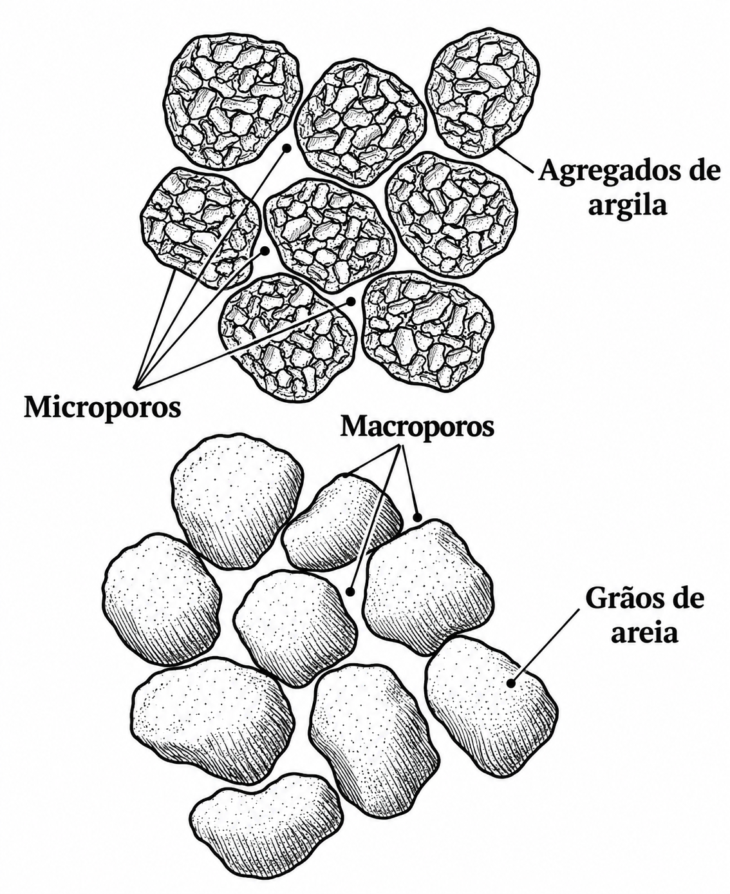

# O que é porosidade?
<hr>

## O que é porosidade?
<hr>

::: {.fragment}

Porosidade é o espaço do solo não ocupado pela fração sólida, onde circulam o ar e a água.

:::

::: {.incremental}

- O solo é um sistema trifásico: sólido, líquido e gasoso;
- Os poros correspondem ao espaço ocupado pelas frações líquida e gasosa;
- A porosidade é variável no espaço, no tempo e na profundidade do solo.

:::

## O que é porosidade?
<hr>

A porosidade total (P~t~) é a relação entre o **volume de poros** (V~p~) e o **volume total** (V~t~) do solo.

::: {.incremental}

- Pode ser expressa em decimal ou em percentagem;
- Está diretamente relacionada com a densidade do solo e a densidade de partículas;
- Quanto maior a densidade do solo, menor tende a ser a porosidade.

:::

## Porosidade do solo
<hr>

{fig-align="center"}


::: {.fragment}

$$Pt = \frac{Vpo}{Vt}=\frac{Var+Vag}{Vt}$$

:::


## Porosidade do solo
<hr>

A porosidade é fixa?

::: {.fragment}

Como modificar?

:::

::: {.fragment}

O arranjo das partículas sólidas define o espaço poroso, o qual pode ser alterado por manejo!

:::

## Porosidade do solo
<hr>

[__Tipos de poros:__]{.fg style="--col: #e64173"}

::: {.incremental}

- **Macroporos**: poros de maior diâmetro (> 0,05 mm);
  - Responsáveis pela aeração e drenagem da água por gravidade;
- **Microporos**: poros de menor diâmetro (< 0,05 mm);
  - Responsáveis pela retenção de água por capilaridade (força maior do que a força gravitacional);

:::

::: {.fragment}

$$P_t = Macroporosidade + Microporosidade$$

:::

## Porosidade do solo
<hr>

{fig-align="center"}

## Porosidade do solo
<hr>

[__Classificação dos poros do solo__]{.fg style="--col: #e64173"}

::: {.incremental}

- **Macroporos** — > 0,05 mm
  - Drenagem da água gravitacional.
  - Favorecem a circulação de ar.
  - Permitem o crescimento das raízes.
  - Podem constituir habitat de organismos do solo.

- **Mesoporos** — 0,03–0,05 mm
  - Retêm água após a drenagem.
  - Movimentam a água por capilaridade.
  - Associados à atividade de fungos e pelos radiculares.


:::

## Porosidade do solo
<hr>

[__Classificação dos poros do solo__]{.fg style="--col: #e64173"}

::: {.incremental}

- **Microporos** — 0,005–0,03 mm
  - Geralmente presentes no interior dos agregados.
  - Retêm água disponível às plantas.
  - Constituem habitat de muitas bactérias.

- **Ultramicroporos** — 0,0001–0,005 mm
  - Associados a agrupamentos de argila.
  - Retêm água pouco ou não disponível às plantas.
  - Limitam o acesso da maioria dos microrganismos.


:::

## Porosidade do solo
<hr>

[__Classificação dos poros do solo__]{.fg style="--col: #e64173"}

::: {.incremental}

- **Criptoporos** — < 0,0001 mm
  - Retêm água fortemente.
  - Dimensão que restringe a presença de microrganismos e moléculas maiores.

:::

# Determinação da porosidade do solo
<hr>

## Determinação da porosidade do solo
<hr>

Os métodos podem ser diretos (medindo diretamente o espaço poroso) ou indiretos (calculados a partir da massa de água).

::: {.fragment}

**Amostras com estrutura preservada!**

:::

::: {.fragment}

Principais métodos:

::: {.incremental}

- Cálculo a partir da massa de água;
- Mesa de tensão (separação de macro e microporos);

:::

:::

## Determinação da porosidade total do solo
<hr>

[__Método direto:__]{.fg style="--col: #e64173"}

A porosidade total pode ser obtida pela determinação do volume de água contido nos poros do solo.

::: {.fragment}

Isso é feito saturando-se uma amostra de solo com volume conhecido. Considerando que a densidade da água é aproximadamente $1\ \text{g cm}^{-3}$, a massa de água, em gramas, é numericamente igual ao seu volume, em $\text{cm}^3$.

:::

::: {.fragment}

Após a saturação, a amostra é pesada, obtendo-se a **massa do solo saturado**. Em seguida, a amostra é seca em estufa a **105 °C** até massa constante e novamente pesada, obtendo-se a **massa do solo seco**.

:::

## Determinação da porosidade total do solo
<hr>

::: {.fragment}


A diferença entre as massas corresponde à **massa de água presente nos poros**:

$$
m_{\mathrm{água}} =
m_{\mathrm{saturado}} -
m_{\mathrm{seco}}
$$

Como $\rho_{\mathrm{água}} \approx 1\ \text{g cm}^{-3}$:

$$
V_{\mathrm{poros}}
\approx
V_{\mathrm{água}}
=
m_{\mathrm{água}}
$$

:::

::: {.fragment}

Assim, conhecendo o volume total da amostra:

$$
\text{Porosidade} =
\frac{V_{\mathrm{poros}}}{V_{\mathrm{total}}}
\times 100
$$

:::


## Determinação da porosidade do solo
<hr>


## Determinação da porosidade do solo
<hr>

[__Mesa de tensão:__]{.fg style="--col: #e64173"}

::: {.fragment}

Utilizada para separar a macro e a microporosidade, a partir da umidade retida sob determinada tensão.

:::

::: {.fragment}

Etapas:

::: {.incremental}

- Amostras com estrutura preservada são saturadas com água;
- As amostras são submetidas a uma tensão de 6 kPa (60 cm de coluna de água);
- A água retida acima dessa tensão corresponde à microporosidade;
- A diferença entre a saturação e a microporosidade corresponde à macroporosidade.

:::

:::

## Determinação da porosidade do solo
<hr>

[__Mesa de tensão:__]{.fg style="--col: #e64173"}

::: {.fragment}

$$Microporosidade = \frac{(M_{u}-M_{s})}{V_t}=\frac{V_a}{V_t}$$

M~u~ = massa da amostra saturada após tensão de 6 kPa (g); M~s~ = massa da amostra seca em estufa (g); V~t~ = volume total do cilindro (cm^3^).

:::

::: {.fragment}

$$Macroporosidade = P_t - Microporosidade$$

:::

## Determinação da porosidade do solo
<hr>

[__Mesa de tensão:__]{.fg style="--col: #e64173"}

Exemplos:

::: {.fragment}

Um cilindro de 100 cm^3^ apresentou porosidade total de 55%. Após submetida à tensão de 6 kPa, a amostra reteve 30 cm^3^ de água. Qual a macro e a microporosidade?

:::

::: {.fragment}

$$Microporosidade = \frac{30}{100}*100 = 30\%$$

:::

::: {.fragment}

$$Macroporosidade = 55-30 = 25\%$$

:::

# Fatores que afetam a porosidade do solo
<hr>

## Fatores que afetam a porosidade do solo
<hr>

::: {.columns}

::: {.column}

::: {.fragment}

**Intrínsecos**

::: {.incremental}

- Textura;
- Estrutura;
- Mineralogia;
- Matéria orgânica.

:::

:::

:::

::: {.column}

::: {.fragment}

**Extrínsecos**

::: {.incremental}

- Máquinas e implementos agrícolas;
- Tráfego de máquinas e animais;
- Manejo e sistema de cultivo.

:::

:::

:::

:::

## Fatores que afetam a porosidade do solo
<hr>

[__Textura:__]{.fg style="--col: #e64173"}

::: {.incremental}

- Solos arenosos: poros maiores, porém em menor quantidade (menor P~t~ total, maior macroporosidade relativa);
- Solos argilosos: poros menores e em maior quantidade (maior P~t~ total, maior microporosidade relativa).

:::

## Fatores que afetam a porosidade do solo
<hr>

[__Compactação:__]{.fg style="--col: #e64173"}

::: {.fragment}

O tráfego de máquinas reduz principalmente a macroporosidade, prejudicando a aeração e a infiltração de água.

:::

## Relação entre a porosidade e aspectos agronômicos
<hr>

[__Porosidade de aeração:__]{.fg style="--col: #e64173"}

::: {.incremental}

- Valores de macroporosidade abaixo de 10% são considerados limitantes ao crescimento radicular;
- A restrição de oxigênio afeta a respiração radicular e a absorção de nutrientes;
- Solos compactados apresentam menor macroporosidade e maior risco de deficiência de aeração.

:::

## Relação entre a porosidade e aspectos agronômicos
<hr>

[__Infiltração e armazenamento de água:__]{.fg style="--col: #e64173"}

::: {.incremental}

- Macroporos: condução rápida de água (infiltração e drenagem);
- Microporos: armazenamento de água disponível às plantas;
- O equilíbrio entre macro e microporosidade é essencial para o manejo da água no solo.

:::

# Relações entre propriedades
<hr>

## Relações entre propriedades
<hr>

$$
P_t =
\frac{V_p}{V_t}
=
\frac{V_t - V_s}{V_t}
=
\frac{
\frac{M_s}{D_s} - \frac{M_s}{D_p}
}{
\frac{M_s}{D_s}
}
=
1- \frac{M_s}{D_p}*\frac{D_s}{M_s}
=
1 -
\frac{D_s}{D_p}
$$

::: {style="font-size:22px"}

- $P_t$ — **porosidade total do solo**, expressa como fração ou porcentagem (%).

- $V_p$ — **volume de poros** do solo, ou seja, o volume ocupado pelo espaço poroso.

- $V_t$ — **volume total da amostra de solo**, correspondente à soma do volume dos sólidos e do volume de poros.

- $V_s$ — **volume ocupado pelos sólidos** do solo.

- $M_s$ — **massa de sólidos do solo**, geralmente expressa em g.

- $D_s$ — **densidade do solo**, definida como a razão entre a massa de sólidos e o volume total da amostra:

- $D_p$ — **densidade de partículas**, definida como a razão entre a massa de sólidos e o volume ocupado exclusivamente pelas partículas sólidas:

:::

# Exercícios
<hr>

## Exercícios
<hr>

```{r}

library(countdown)

countdown(
  minutes = 5,
  seconds = 0,
  right = 0,
  top = 0,
  padding = "5px",
  margin = "0%",
)
```

1 - Um cilindro de 100 cm^3^ apresentou porosidade total de 50%. Após tensão de 6 kPa, a amostra reteve 18 cm^3^ de água. Qual a macro e a microporosidade dessa amostra?

::: {.fragment}

Resposta:

$$Microporosidade = \frac{18}{100}= 0,18 cm^3 cm^3 (18\%)$$

:::

::: {.fragment}

$$Porosidade~total = \frac{100*50}{100}= 50$$

:::

::: {.fragment}

$$Macroporosidade = \frac{(50-18)}{100}= 0,32 cm^3 cm^3 (32\%)$$

:::

## Exercícios
<hr>

```{r}

library(countdown)

countdown(
  minutes = 5,
  seconds = 0,
  right = 0,
  top = 0,
  padding = "5px",
  margin = "0%",
)
```

2 - Um cilindro de 200 cm^3^ apresentou porosidade total de 45%. Após tensão de 6 kPa, a amostra reteve 52 cm^3^ de água. Qual a macro e a microporosidade dessa amostra?

::: {.fragment}

Resposta:

$$Microporosidade = \frac{52}{200}= 0,26 cm^3 cm^3 (26\%)$$

:::

::: {.fragment}

$$Porosidade~total = \frac{200*45}{100}= 90$$

:::

::: {.fragment}

$$Macroporosidade = \frac{(90-52)}{200}= 0,19 cm^3 cm^3 (19\%)$$

:::

## Exercícios
<hr>

```{r}

library(countdown)

countdown(
  minutes = 5,
  seconds = 0,
  right = 0,
  top = 0,
  padding = "5px",
  margin = "0%",
)
```

3 - Um cilindro de 150 cm^3^ apresentou porosidade total de 60%. Após tensão de 6 kPa, a amostra reteve 45 cm^3^ de água. Qual a macro e a microporosidade dessa amostra?

::: {.fragment}

Resposta:

$$Microporosidade = \frac{45}{150}= 0,3 cm^3 cm^3 (30\%)$$

:::

::: {.fragment}

$$Porosidade~total = \frac{150*60}{100}= 90$$

:::

::: {.fragment}

$$Macroporosidade = \frac{(90-45)}{150}= 0,3 cm^3 cm^3 (30\%)$$

:::

## Exercícios
<hr>

```{r}

library(countdown)

countdown(
  minutes = 5,
  seconds = 0,
  right = 0,
  top = 0,
  padding = "5px",
  margin = "0%",
)
```

4 - Um cilindro de 250 cm^3^ apresentou porosidade total de 48%. Após tensão de 6 kPa, a amostra reteve 80 cm^3^ de água. Qual a macro e a microporosidade dessa amostra?

::: {.fragment}

Resposta:

$$Microporosidade = \frac{80}{250}= 0,32 cm^3 cm^3 (32\%)$$

:::

::: {.fragment}

$$Porosidade~total = \frac{250*48}{100}= 120$$

:::

::: {.fragment}

$$Macroporosidade = \frac{(120-80)}{250}= 0,16 cm^3 cm^3 (16\%)$$

:::

## Exercícios
<hr>

```{r}

library(countdown)

countdown(
  minutes = 5,
  seconds = 0,
  right = 0,
  top = 0,
  padding = "5px",
  margin = "0%",
)
```

5 - Um cilindro de 180 cm^3^ apresentou porosidade total de 55%. Após tensão de 6 kPa, a amostra reteve 63 cm^3^ de água. Qual a macro e a microporosidade dessa amostra?

::: {.fragment}

Resposta:

$$Microporosidade = \frac{63}{180}= 0,35 cm^3 cm^3 (35\%)$$

:::

::: {.fragment}

$$Porosidade~total = \frac{180*55}{100}= 99$$

:::

::: {.fragment}

$$Macroporosidade = \frac{(99-63)}{180}= 0,2 cm^3 cm^3 (20\%)$$

:::

## Exercícios
<hr>

```{r}

library(countdown)

countdown(
  minutes = 5,
  seconds = 0,
  right = 0,
  top = 0,
  padding = "5px",
  margin = "0%",
)
```

6 - Uma amostra de solo apresentou densidade do solo de 1,35 g cm^-3^ e densidade de partícula de 2,70 g cm^-3^. Qual a porosidade total desse solo?

::: {.fragment}

Resposta:

$$P_t = \left(1-\frac{D_s}{D_p}\right)*100$$

:::

::: {.fragment}

$$P_t = \left(1-\frac{1,35}{2,70}\right)*100$$

:::

::: {.fragment}

$$P_t = 50~\%$$

:::

## Exercícios
<hr>

```{r}

library(countdown)

countdown(
  minutes = 5,
  seconds = 0,
  right = 0,
  top = 0,
  padding = "5px",
  margin = "0%",
)
```

7 - Um solo apresenta densidade de partícula de 2,65 g cm^-3^ e porosidade total de 42%. Qual a densidade desse solo?

::: {.fragment}

Resposta:

$$P_t = \left(1-\frac{D_s}{D_p}\right)*100$$

:::

::: {.fragment}

$$42 = \left(1-\frac{D_s}{2,65}\right)*100$$

:::

::: {.fragment}

$$D_s = 2,65*(1-0,42) = 1,54~g~cm^3$$

:::


# Fim!
<hr>
